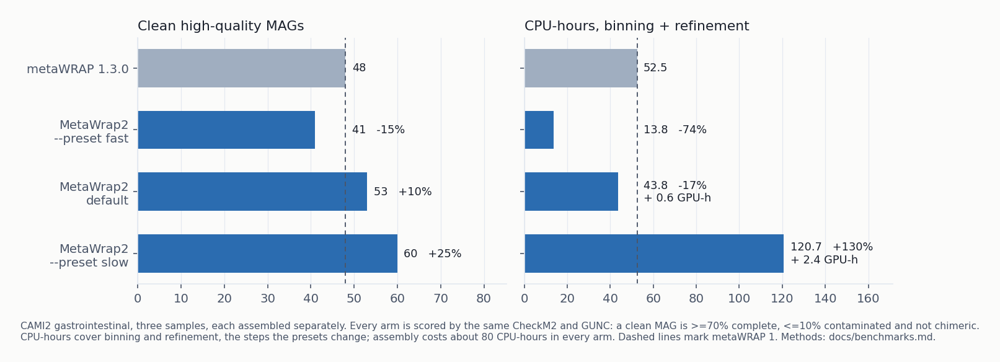

# MetaWrap2: a benchmarked pipeline for genome-resolved metagenomics, from reads to MAGs and their functions

MetaWrap2 is an end-to-end metagenomics pipeline for shotgun sequencing data. It recovers
metagenome-assembled genomes (MAGs) from Illumina short reads or Nanopore and PacBio long reads, and
then annotates what those genomes and the rest of the community do. One installation covers:

- **Read QC and assembly:** adapter and quality trimming, host read removal, and assembly with
  MEGAHIT, metaSPAdes or metaFlye.
- **Metagenomic binning and bin refinement:** metaBAT2, MaxBin2, CONCOCT, SemiBin2, VAMB and COMEBin,
  combined into a better bin set than any single binner, with CheckM or CheckM2 quality scores and
  GUNC chimera detection.
- **Genome catalogues across samples:** cross-sample coverage, bin reassembly, dereplication into
  one non-redundant MAG catalogue, abundance across samples, and taxonomy with GTDB-Tk.
- **Functional annotation:** gene calling, KEGG orthologs, KEGG pathway and module completeness,
  Pfam domains, CAZymes and biosynthetic gene clusters, per genome and per sample.
- **Beyond bins:** antimicrobial resistance (AMR) genes with their genomic context, viruses and
  their hosts, strain-level comparison between samples, pangenomes, phylogenetic trees and
  differential abundance.

MetaWrap2 is the successor to [metaWRAP](https://github.com/bxlab/metaWRAP), rewritten in Python,
with its defaults chosen by benchmarking. Each module is one file with the exact
tool commands at the top: open [`src/metawrap2/modules/binning.py`](src/metawrap2/modules/binning.py),
find the `COMMANDS` block, and edit a flag there.

> Experimental. Interfaces may still change, and the benchmarks so far use one dataset, so
> validate your results. Coming from metaWRAP 1.x? See [Migrating](#migrating).


## Installation

```bash
git clone https://github.com/ursky/MetaWrap2.git && cd MetaWrap2
pip install .                # or: pip install -e .   (to edit the code)
metawrap2 quickstart -t 8    # build the conda environments, then verify each
```

The tools run in conda environments grouped by workflow: one for read processing and assembly, one
for binning, and so on. `quickstart` builds them and checks that each tool runs. `--binning-only`
installs just what genome recovery needs. If you manage the tools yourself, set
`use_conda_envs = false` in `metawrap2.toml` and MetaWrap2 runs them from your `PATH`.

The default binners include SemiBin2, which needs pytorch (about 1.5 GB). `quickstart` installs
it. To avoid it, run binning with `--preset fast` (metaBAT2 and MaxBin2).

## Measured against metaWRAP 1

The default recovers 10% more clean genomes than metaWRAP 1 for 17% less compute. `--preset slow`
recovers 25% more.



CAMI2 gastrointestinal data, three samples, each assembled separately. A "clean MAG" is a bin that
is at least 70% complete, at most 10% contaminated, and not chimeric according to GUNC.

| | Clean MAGs | CPU-hours (binning + refinement) |
|---|---|---|
| metaWRAP 1.3.0 | 48 | 52.5 |
| MetaWrap2, `--preset fast` | 41 | 13.8 |
| MetaWrap2, default | 53 | 43.8 |
| MetaWrap2, `--preset slow` | 60 | 120.7 |

Methods, figures and open questions are in [docs/benchmarks.md](docs/benchmarks.md). The results
table behind them is in [benchmarks/results/](benchmarks/results/).

## Databases

Databases are only needed by the modules that use them, and nothing is downloaded until you ask.

```bash
metawrap2 install-db --list                          # every database, its size, and its users
metawrap2 install-db checkm gunc host --small -t 3   # enough to recover genomes
```

| Database | Full size | `--small` | Used by |
|:---|:---:|:---:|:---|
| CheckM | 1.4 GB | – | `bin_refinement`, `reassemble_bins`, `binning --run-checkm` |
| CheckM2 | 1.7 GB | – | `bin_refinement --checkm2` |
| GUNC | 6.7 GB | – | `bin_refinement`, unless `--skip-gunc` |
| KRAKEN2 standard | ~90 GB | 8 GB | `kraken2` |
| NCBI nt | ~300 GB | ~2 GB | `blobology`, `classify_bins` |
| NCBI taxonomy | 550 MB | – | `blobology`, `classify_bins` |
| Indexed host genome | ~20 GB | ~9 GB | `read_qc` |
| KOfam profiles and thresholds (`kofam`) | 1.5 GB | – | `annotate --kofam` |
| KEGG BRITE hierarchy (`kegg`) | 4 MB | – | `pathways` hierarchy and Krona charts |
| Pfam-A | 399 MB | – | `annotate --pfam` |
| dbCAN | 7.4 GB | – | `annotate --cazy` |
| Bakta | 30 GB | 1.3 GB | `annotate --bakta` |
| AMRFinderPlus | 200 MB | – | `amr` |
| CARD | 4 MB | – | `amr --rgi` |
| geNomad | 1.5 GB | – | `viruses`, `amr --mobile-elements` |
| CheckV | 6.4 GB | – | `viruses` |
| SingleM metapackage | 2.2 GB | – | `appraise` |
| GTDB-Tk | ~110 GB | – | `classify_bins --gtdbtk` |

`install-db --list` is the authoritative version of this table.

## Running

Every module runs on its own; `metawrap2 <module> --help` lists its options. A typical
genome-recovery run:

```bash
metawrap2 read_qc -1 reads_1.fastq.gz -2 reads_2.fastq.gz -o READ_QC -t 24
metawrap2 assembly -1 READ_QC/final_pure_reads_1.fastq -2 READ_QC/final_pure_reads_2.fastq \
    -o ASSEMBLY -t 24 -m 64 --metaspades
metawrap2 binning -a ASSEMBLY/final_assembly.fasta -o INITIAL_BINNING -t 24 \
    --preset default reads_1.fastq reads_2.fastq
metawrap2 bin_refinement -o BIN_REFINEMENT -t 24 -c 70 -x 10 \
    -A INITIAL_BINNING/metabat2_bins -B INITIAL_BINNING/semibin2_bins
```

Read files can be gzip- or bzip2-compressed. Pairs are recognised as `_1/_2`, `_R1/_R2`,
`_R1_001/_R2_001` or `.1/.2`. `bin_refinement` accepts up to six bin directories from any binner.
Bins are named `bin_001.fasta`, and the `.stats.tsv` next to each bin folder gives completeness,
contamination, GC, lineage and N50 per bin.

For a whole study, describe the samples once in a sample sheet. `metawrap2 run` co-assembles them.
`metawrap2 cohort` assembles and bins each sample separately, measures coverage across all samples
in one pass, and dereplicates the bins into one genome catalogue:

```bash
metawrap2 run --example > samples.toml   # a commented sheet to edit
metawrap2 cohort samples.toml -o study/ -t 96 -j 4
```

Both can resume from the last finished step. [docs/usage.md](docs/usage.md) explains which to use
and how to write a sheet.

Global options go before the module name:

```bash
metawrap2 --dry-run   binning -a asm.fa -o out ...   # print the commands, run nothing
metawrap2 --resume    binning -a asm.fa -o out ...   # skip steps whose outputs are still valid
metawrap2 --force     binning -a asm.fa -o out ...   # overwrite an existing output directory
metawrap2 --max-threads 32  ...                      # a thread ceiling for the whole run
```

## Modules

| | Module | What it does |
|---|---|---|
| Reads | `read_qc` | Trimming (fastp or Trim Galore) and host read removal |
| | `assembly` | Assembly with MEGAHIT or metaSPAdes, or metaFlye for long reads |
| | `kraken2` | Taxonomic profile of reads or contigs |
| | `nonpareil` | How much of each sample's diversity was sequenced, and whether samples are comparable |
| Genomes | `binning` | metaBAT2, MaxBin2, CONCOCT, SemiBin2, VAMB and COMEBin; long-read and multi-split modes |
| | `coverage` | One depth table across all samples of a cohort |
| | `bin_refinement` | Combines several bin sets into a better one and checks for chimeras |
| | `reassemble_bins` | Reassembles each bin from its own reads |
| | `dereplicate` | Collapses bins from many samples into one non-redundant catalogue |
| | `quant_bins` | Bin abundance in each sample (sylph, salmon, CoverM or the depth table) |
| | `classify_bins` | Taxonomy for each bin |
| | `appraise` | What share of the community the bins represent, and which lineages are missing |
| | `blobology` | GC-versus-abundance plots of contigs and bins |
| Function | `annotate` | Gene calling on bins or a whole assembly, with KEGG orthologs, Pfam domains, CAZymes and biosynthetic gene clusters |
| | `pathways` | KEGG module completeness and the functional hierarchy, per genome and per sample, with Krona charts |
| | `quantify_function` | Gene and pathway abundance per sample |
| | `catalogue` | A non-redundant gene catalogue across samples, annotated once and quantified by read mapping |
| | `amr` | Resistance and virulence genes with their genomic context and an evidence level (AMRFinderPlus and/or RGI) |
| | `diff_abundance` | Features that differ between sample groups, tested compositionally (ANCOM-BC) |
| Beyond bins | `viruses` | Viral contigs, their completeness, vOTUs and CRISPR-predicted hosts |
| | `strains` | Within-population variation and strain sharing between samples (inStrain and/or TRACS) |
| | `pangenome` | A pangenome for each species in a cohort |
| | `phylogeny` | A tree from a marker or core-gene alignment, with support values |

`annotate_bins` still runs but is deprecated in favour of `annotate`. The taxator-tk route in
`classify_bins` is deprecated in favour of `--gtdbtk`.

Bin quality is scored with CheckM by default. `bin_refinement --checkm2` uses CheckM2 instead,
which needs much less memory. Two other modules have opt-in engines of the same kind:
`classify_bins --gtdbtk` and `annotate --bakta`.

`bin_refinement` and `reassemble_bins` implement metaWRAP's own algorithms. Both are unchanged and
checked by [golden tests](tests/test_bin_refinement_golden.py).

You do not have to pick binners by hand. `--preset {very-fast,fast,default,slow}` picks a set by
how much compute you have, and any binner you name yourself takes precedence. Learned binners train
on the CPU unless you pass `--device cuda` or `--device auto`, so by default a study gives the same
bins on any machine.

## Release notes

Each release has a page in [docs/releases/](docs/releases/) listing what it added, which defaults
changed and why, and what is still open. The current release is [2.1.2](docs/releases/2.1.2.md).

## Migrating

Mostly a rename. `metawrap2 config migrate <old-config>` converts a metaWRAP 1 shell config.

- The command is `metawrap2` (also installed as `mw2`). Module names are unchanged. The config file
  is `metawrap2.toml`.
- Tools run in conda environments created by `metawrap2 quickstart`.
- The `kraken` (KRAKEN1) module and `--metabat1` are gone; use `kraken2` and `--metabat2`.
- `.stats` and `.contigs` files are now `.stats.tsv` and `.contigs.tsv`, with the same contents.
  Bins are `bin_001.fasta` for every binner, so a script that globs `*.fa` needs `*.fasta`.
- Four defaults changed, each on a measurement in [docs/benchmarks.md](docs/benchmarks.md). To
  reproduce a metaWRAP 1 result:

  | | MetaWrap2 default | metaWRAP 1 behaviour |
  |---|---|---|
  | Trimming | fastp | `--trimmer trim-galore` |
  | Bin abundance | sylph | `--quantifier salmon` |
  | Binners | metaBAT2 + SemiBin2 | `--preset fast` (metaBAT2 + MaxBin2) |
  | Depth-table identity floor | 90% | `--min-identity 97` |

- GUNC runs on the final bins and flags chimeric ones. `--skip-gunc` turns it off, and then its
  database is not needed.

## What else is new

Benchmarking
- `metawrap2 benchmark` runs a comparison against a dataset with a known answer and writes the
  result to a committed table. Comparisons are defined in `benchmarks/configurations.toml`, so
  adding one is a TOML entry.
- Cost is measured in CPU-hours.

Cohorts
- `metawrap2 run` and `cohort` execute a whole study from a sample sheet, step by step.
- `metawrap2 coverage` gives every binner each contig's depth in every sample, with one alignment
  per sample. Cross-sample coverage is what separates two genomes that are equally abundant in any
  single sample.
- `metawrap2 dereplicate` collapses per-sample bins into one catalogue of organisms.

Function and beyond
- `annotate` calls genes once, on bins or on the whole assembly, and every later module reads the
  same table. Annotating the assembly covers the roughly 90% of sequence that never ends up in a
  MAG.
- `pathways` computes KEGG module completeness itself and reports both published definitions,
  because published tools disagree on it.
- Sample-level function can be weighted by MAG abundance, contig depth or gene abundance, and every
  table says which was used.
- `amr` gives each resistance call its genomic context and an evidence level. Its two backends are
  joined on ARO terms.

Installation
- `metawrap2 install-db` downloads, unpacks, indexes and configures databases (`--small` for test
  sizes).
- `metawrap2 doctor` reports, per module, whether its environment and tools are installed, missing
  or broken, and whether its databases are complete. `--fix` rebuilds only what is broken.
- Lockfiles (`install-env --lock` and `--from-lock`) pin every package build for reproducible
  environments.

Running and resuming
- Read layouts beyond metaWRAP's `_1.fastq`/`_2.fastq` are detected automatically, and
  `--single-end` and `--interleaved` are supported.
- `--resume` skips a step only if it finished, its outputs are present and non-empty, and its inputs
  are unchanged. `metawrap2 status <dir>` shows what a resume would do.
- Inputs are checked before a tool starts (empty file, wrong format, truncated gzip).
  `--skip-validation` turns the checks off if one misfires.
- Ctrl-C, SIGTERM and SIGHUP mark the running step as interrupted, so `--resume` redoes it. A lock
  file stops two runs from writing to the same directory.

Resources
- One resource budget per run (`--max-threads`, `--max-memory-gb`, `--max-gpus`, or `[limits]` in
  the config), by default a share of the machine. Peak memory is recorded for every step.
- A disk-space check runs before each step, and a run stops before it fills the disk. One scratch
  setting (`scratch_dir` or `$METAWRAP2_SCRATCH`) applies to every module.
- `metawrap2 calibrate` compares the built-in disk and memory estimates with real runs.

Provenance
- Every run writes `run_config.json` (parameters, commands and tool versions), `run_commands.txt`,
  `provenance.txt` (carried through chained runs), `run_environment.json` (the full conda package
  list) and `metawrap2.log`.
- `metawrap2 history` logs every run on the machine, and `history --diff RUN RUN` compares two.
- Tool output is shown live and saved, with progress bars and repeated messages collapsed
  (`--verbose-logs` keeps everything).

Code
- The repository is Python only, with no shell, Perl or R scripts; CI enforces this.
- Every command's `--help` shows its defaults and accepted values.

## Notes

- Requirements scale with the data; 8 cores and 64 GB of RAM is a reasonable minimum. Linux x64 is
  supported, macOS works, and Python 3.10 or later is required.
- To change what a module runs, edit the `COMMANDS` or `CONSTANTS` block at the top of its file, or
  override settings in `~/.metawrap2/config.toml`.
- Development setup is in [CONTRIBUTING.md](CONTRIBUTING.md); planned work is in
  [PLANNED_FEATURES.md](PLANNED_FEATURES.md).
- When reporting a bug, include the output of `metawrap2 -v`, the full error, and the run's
  `metawrap2.log`.

## Authors and citation

MetaWrap2 is developed by [Gherman Uritskiy](https://www.linkedin.com/in/gherman-uritskiy-phd-978075b8/)
(Amazon) and [Michael Schatz](http://schatz-lab.org/) (Johns Hopkins University).

There is no MetaWrap2 paper yet. Until there is, please cite metaWRAP:
Uritskiy GV, DiRuggiero J, Taylor J. *MetaWRAP — a flexible pipeline for genome-resolved metagenomic
data analysis.* Microbiome (2018).
[doi:10.1186/s40168-018-0541-1](https://microbiomejournal.biomedcentral.com/articles/10.1186/s40168-018-0541-1)

Please also cite the tools your analysis relied on, such as metaBAT2, SemiBin2, MaxBin2, CONCOCT,
SPAdes, MEGAHIT, Kraken2, CheckM, GUNC and sylph.
