# Benchmarks

MetaWrap2 is a Python-native rewrite of metaWRAP. This page lists what it adds over metaWRAP 1 and
the measured effect of each addition. metaWRAP 1.3.0 is the baseline throughout.

| | metaWRAP 1.3.0 | MetaWrap2 |
|---|---|---|
| cohort runs | one sample at a time, by hand | `run` / `cohort` from a sheet, resumable per step |
| cross-sample coverage | none | `coverage`: one depth table, N alignments instead of N² |
| dereplication | none | `dereplicate`: a cohort's bins collapsed to organisms |
| binners | metaBAT2, MaxBin2, CONCOCT | those three plus SemiBin2, VAMB, COMEBin, GPU-capable |
| which binners run | one fixed set | `--preset default` or `deep`, 114 and 177 clean MAGs |
| depth table | `jgi_summarize_bam_contig_depths` | own implementation; identity floor measured and moved |
| chimera detection | none | GUNC on every final bin set, on by default |
| consolidation | CheckM on every combination | unions and differences of overlapping bins added (2.1.6); metaWRAP 1's method as `--mw1-refinement`, minus repeat and ruled-out calls |
| bin abundance | salmon | sylph default, four quantifiers measured |
| read capping for reassembly | none | `--max-coverage`, default 50× |
| defaults chosen by | the author | `metawrap2 benchmark`, results committed |
| install | one env, manual | 9 workflow envs, `install-env` / `install-db` / `doctor` |

---

# Methods

Data. CAMI2 human microbiome challenge, short read: gastrointestinal samples 0, 1 and 10 unless
stated, plus three oral and three skin samples in §2.1 to §2.3. CAMI2 ships a pooled gold-standard
assembly and a contig-to-genome truth table.

There are two designs, and no figure mixes them:

- End-to-end arms give each pipeline the same raw reads to assemble itself; used for the metaWRAP 1
  comparison. AMBER cannot score them, since its truth refers to gold-assembly contig names.
- Binner arms bin the gold assembly directly, removing assembler variance and allowing AMBER.

Quality. CheckM2 assigns MIMAG tiers (near-complete ≥90% complete / ≤5% contaminated, high-quality
≥70/≤10) and GUNC scores chimerism. The headline metric is clean high-quality MAGs: bins that are
≥70/≤10 and non-chimeric, counted by joining the two reports per bin (an HQ count times a per-set GUNC pass fraction
understated one arm by 18 genomes, §8). The same CheckM2 and GUNC score every arm, including
metaWRAP 1, which refines internally with CheckM 1.0.18. The exception is the CAMI2
gastrointestinal end-to-end comparison (§2): its MetaWrap2 arms are scored with CheckM1 and GUNC,
and metaWRAP 1 with CheckM2 and GUNC.

Where AMBER applies, it adds bp-weighted F1, purity and completeness. A bin that is 95% one genome
and 5% another loses little bp-weighted purity, so AMBER is reported with GUNC.

Cost. CPU-hours from reaping each child with `os.wait4`; wall time depends on the cores a tool is
given. Runs outside the harness record no cost and are not used. Cost and quality are reported in
separate columns. A quality-per-cost ranking once selected a default that recovered fewer genomes
than metaWRAP 1.

Harness. `metawrap2 benchmark list|fetch|run|score`. Comparisons are declared in
`benchmarks/configurations.toml` and results go to a committed TSV. `fetch` runs only when asked and
refuses to cross a disk ceiling. It checks every file against its published md5, or decompresses it
where none is published, before accepting it. A matching size alone does not pass a file: one
resumed download had the declared length and a corrupt gzip stream. Where `aria2c` is
available, transfers use several ranged connections, 6-10x the throughput of one connection from a
host that throttles per connection. `metawrap2 score` rescores any bin set with the same CheckM2 and
GUNC outside the harness ([Scoring genomes](score.md)).

External arms. A variant can run another pipeline: it declares an `external` table instead of
`args`, with the `command`, the `bins` path its output lands in (relative to `{output}`), the conda
`env` its tools live in, and a `version` or a `version_command` run in that env. The command is a
template over inputs the runner has already resolved: `{assembly}`, `{reads}`, `{output}`,
`{threads}`, `{memory}`, `{bins}`, `{r1}`, `{r2}`, `{sample}`. It cannot name an input of its own,
so an external arm runs on the same data, samples and grant as the native arms. It is measured by
the same `os.wait4` call. Its bins are published as `<arm>_bins` through per-file symlinks
(metaWRAP 1.3.0 writes `bin.1.fa` and the scorer counts `.fasta`), and scored by the same path.
A declaration is refused at load if it has no command, bins path, env or version, uses a
placeholder the runner cannot fill, does not reference its module's inputs, or backgrounds or
submits its work (which would be measured as the submission). `benchmarks/configurations.toml`
ends with a commented metaWRAP 1.3.0 arm.

External arms replace driver scripts outside the repository. In the metaWRAP 1 comparison those
scripts left one arm with bins and no cost measurement, and defaulted to ten samples where the rows
they were compared against used three.

Baseline. metaWRAP 1.3.0 from its own conda environment at its recipe's pinned versions: metaBAT2
2.12.1, MaxBin2 2.2.5, CheckM 1.0.18, bwa 0.7.18, Python 2.7.15. It runs its own read QC, assembly,
binning and refinement in §2 to §2.3, and its own binning and refinement on the Hadza and
faecal-transplant samples (§2.5). On the gold assemblies (§2.4) and the gut and water
co-assemblies (§2.5) only its refinement runs, over metaBAT2, MaxBin2 and CONCOCT bins made through
MetaWrap2 from MetaWrap2's depth table.

---

# Results

## 1. Cohort support

- `metawrap2 run` / `cohort` execute a study sheet (samples, read paths, steps, per-module options).
  Each step's manifest is fingerprinted on its inputs, and `--resume` reruns only steps whose inputs
  changed.
- `metawrap2 coverage` gives each contig's depth in every sample, from N alignments instead of N², in
  one table the binners read.
- `metawrap2 dereplicate` collapses per-sample bin sets into one catalogue of organisms. Every cohort
  figure here is post-dereplication.

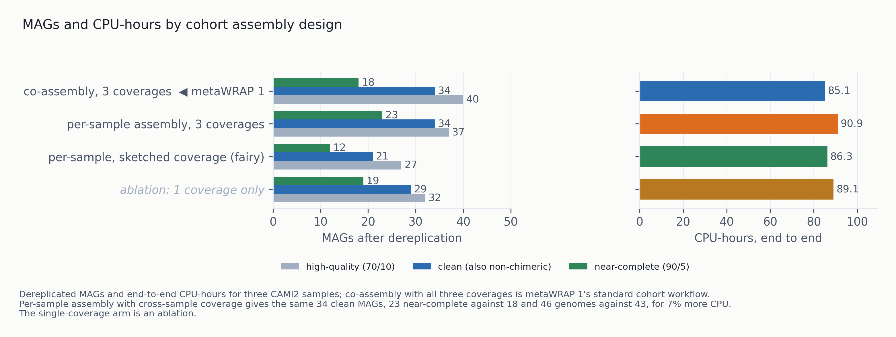

The top two bars give the binner one depth column per sample; co-assembly is metaWRAP 1's cohort
workflow.

| | clean MAGs | near-complete | genomes | CPU-h |
|---|---|---|---|---|
| co-assembly, 3 coverages *(metaWRAP 1's workflow)* | 34 | 18 | 43 | 85.1 |
| per-sample assembly, 3 coverages *(`coverage`)* | 34 | **23** | **46** | 90.9 |

Per-sample assembly gives equal clean MAGs, 5 more near-complete and 3 more organisms for 7% more
CPU, and keeps bins attributable to their sample.

Ablations:

- One coverage column instead of three (bottom bar): 29 clean MAGs against 34, 19 near-complete
  against 23. Building the table costs 2.26 CPU-hours and saves 1.2 in binning, which reads the table
  instead of aligning.
- `--coverage fairy` (k-mer sketches): the coverage step is 53× cheaper and loses 13 of 34 clean MAGs.
  The step is 2.5% of the pipeline, so fairy is not the default.

Scaling is untested. Co-assembly's assembler sees 3× the reads here and would see 20× at twenty
samples, where it is expected to run out of memory. For small cohorts, `coassemble = true` in a sheet
selects it.

## 2. End-to-end comparison with metaWRAP 1

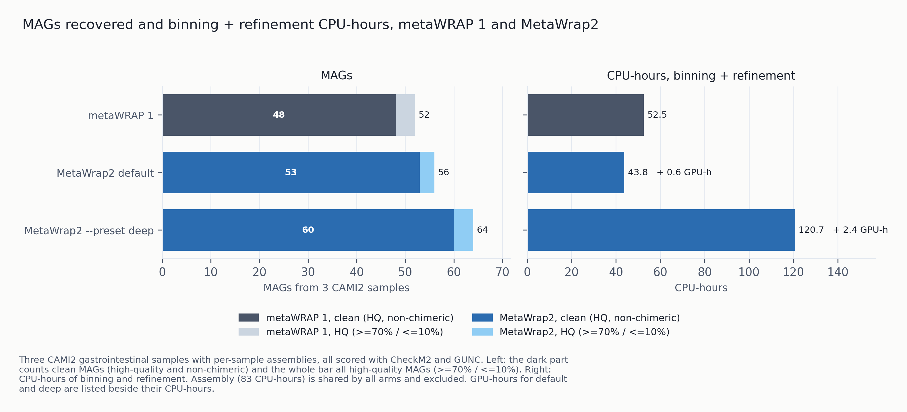

| arm | high-quality | clean | CPU-h *(binning + refinement)* | GPU-h |
|---|---|---|---|---|
| **metaWRAP 1.3.0** | **52** | **48** | **52.5** | - |
| `--preset default` | 56 | **53** | **43.8** | 0.6 |
| `--preset deep` | 64 | **60** | 120.7 | 2.4 |

metaWRAP 1's bins are rescored with CheckM2 and GUNC. The `default` and `deep` counts come from
the CheckM1 and GUNC table that `bin_refinement` wrote; no CheckM2 rescore of them exists, so the
two scorers' counts are not on an identical scale.

All arms share the same assemblies (83 CPU-hours, excluded; including them would reduce the 2.8×
spread between `default` and `deep` to 1.6×). GPU-hours are the wall time of binners run with
`--device cuda`; the CPU-hours for `default` and `deep` assume a GPU.

- `default`: 10% more clean MAGs than metaWRAP 1 for 17% less CPU. Default tier since 2026-10-09.
- `deep`: 25% more clean MAGs for 130% more CPU, with SemiBin2 and COMEBin on a GPU (2.4
  GPU-hours). Three bin sets give 7 hybrid combinations to refine, against `default`'s 3.

The former `fast` and `very-fast` presets (metaBAT2 + MaxBin2, and metaBAT2 alone) returned 41 and
36 clean MAGs for 13.8 and 8.8 CPU-hours, fewer than metaWRAP 1, and are no longer documented.

A plain `metawrap2 run` needs `metawrap2-learned` (~1.5 GB of pytorch), which `quickstart` builds.

These costs are for CAMI2 (3 samples, 17-63k contigs). MaxBin2 slows with more contigs and samples:
on a 418k-contig co-assembly of 36 samples one EM iteration took about 53 minutes, so the default
50 iterations take about 40 hours. `--maxbin2-max-iteration` sets the
limit.

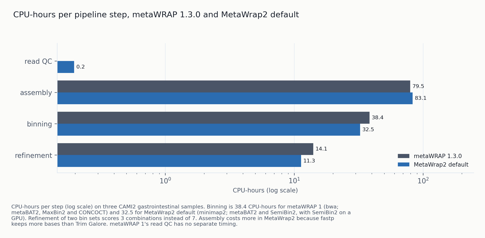

metaWRAP 1's binning costs 38.4 CPU-hours against 32.5 for MetaWrap2 default (minimap2 instead of
bwa; metaBAT2 + SemiBin2, with SemiBin2 on a GPU, instead of three binners).
Refinement of two bin sets scores 3 combinations instead of 7.

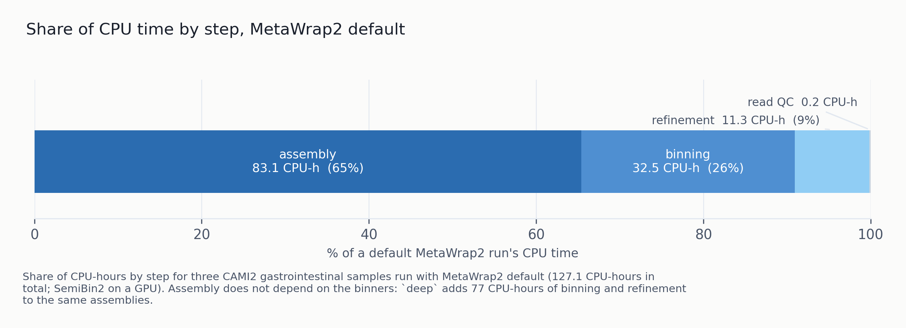

Assembly is about 65% of a default run (83 of 127.1 CPU-hours) and does not depend on the binners.
The tiers differ more on the gold assembly (§3).

### 2.1 Other body sites

Oral and skin, three samples each, per-sample assembly. Skin is a low-diversity community dominated
by a few genera.

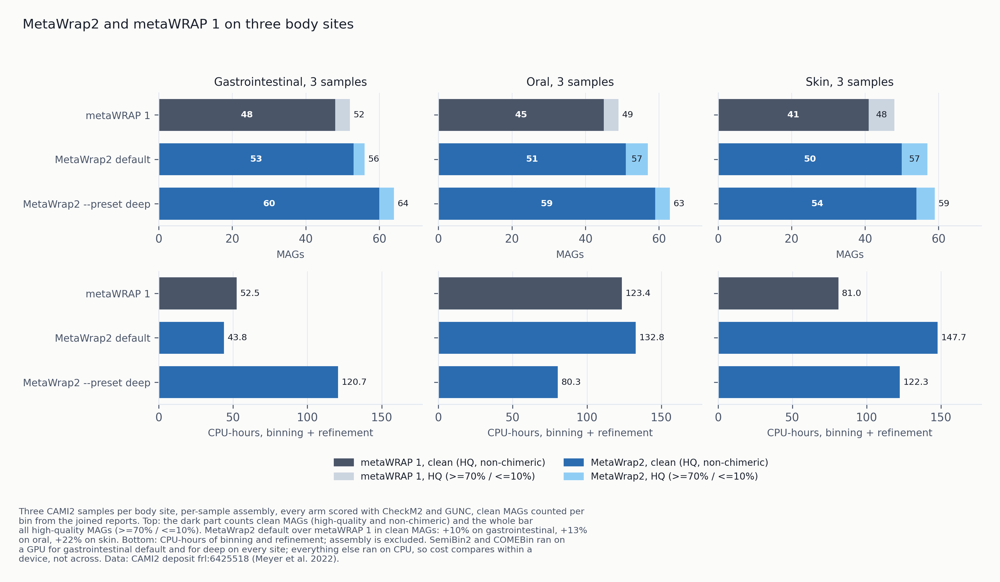

| body site, 3 samples | metaWRAP 1.3.0 | `--preset default` | difference | CPU-h end to end, mw1 vs mw2 |
|---|---|---|---|---|
| gastrointestinal | 48 clean (52 HQ) | **53 clean** (56 HQ) | +10% | 132.0 vs 127.1 |
| oral | 45 clean (49 HQ) | **51 clean** (57 HQ) | +13% | 172.6 vs 184.9 |
| skin | 41 clean (48 HQ) | **50 clean** (57 HQ) | +22% | 136.2 vs 200.2 |

The oral and skin counts and metaWRAP 1's gastrointestinal count use the per-bin CheckM2 ∩ GUNC
join; the MetaWrap2 gastrointestinal count uses CheckM1 ∩ GUNC (§2). The figure adds `--preset deep`, with a binning-plus-refinement cost panel.

Per sample, `default` wins five of the six oral and skin samples and ties one (oral 20/17, 13/10,
18/18; skin 14/10, 17/16, 19/15 clean).

Cost is comparable only within a site. The gastrointestinal arm trained SemiBin2 on a GPU (0.6
GPU-hours) and the oral and skin arms on CPU, the default: 32 against 124-139 CPU-hours of binning.
Against metaWRAP 1, MetaWrap2 is 4% cheaper on gastrointestinal, 7% more expensive on oral and 47%
more expensive on skin (9 more clean MAGs for 64 more CPU-hours).

### 2.2 Presets on CAMI2 oral

Same scoring. Cost is binning plus refinement on the `default` arm's assemblies. `default` ran
SemiBin2 on CPU and `deep` on a GPU, so their costs are not comparable; likewise in §2.3.

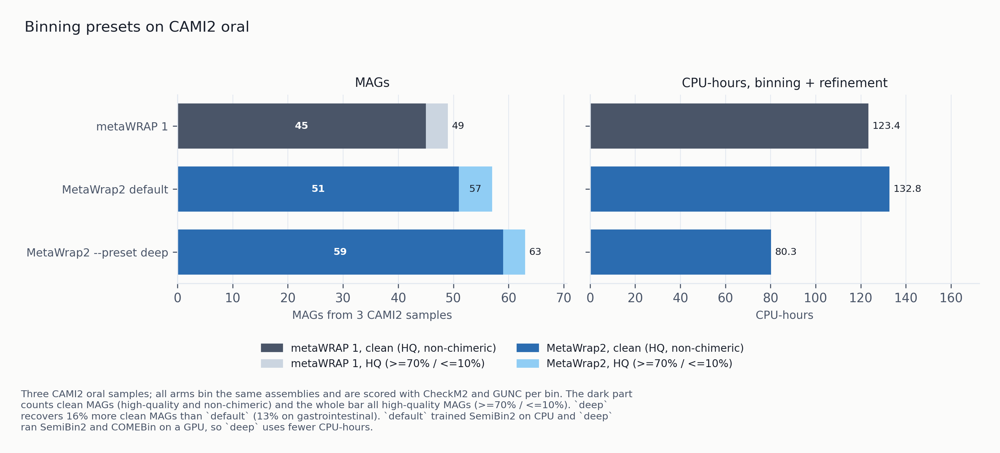

| arm | binners | device | clean | HQ | CPU-h *(binning + refinement)* |
|---|---|---|---:|---:|---:|
| **metaWRAP 1.3.0** | metaBAT2 + MaxBin2 + CONCOCT | cpu | **45** | 49 | 123.4 |
| `--preset default` | metaBAT2 + SemiBin2 | cpu | 51 | 57 | 132.8 |
| `--preset deep` | + COMEBin | cuda | **59** | 63 | 80.3 |

- `deep` recovers 16% more clean MAGs than `default` (13% on gastrointestinal, 60 vs 53) and wins on
  each sample (23/20, 15/13, 21/18). A user-testing run on MetaHIT reads gave +58%.

`deep`'s cost with SemiBin2 and COMEBin on CPU has not been measured.

### 2.3 Presets on CAMI2 skin

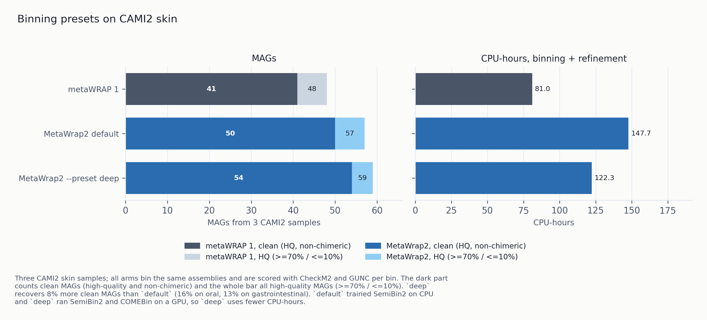

| arm | binners | device | clean | HQ | CPU-h *(binning + refinement)* |
|---|---|---|---:|---:|---:|
| **metaWRAP 1.3.0** | metaBAT2 + MaxBin2 + CONCOCT | cpu | **41** | 48 | 81.0 |
| `--preset default` | metaBAT2 + SemiBin2 | cpu | 50 | 57 | 147.7 |
| `--preset deep` | + COMEBin | cuda | **54** | 59 | 122.3 |

- `deep` recovers 8% more clean MAGs than `default`, against 16% on oral and 13% on gastrointestinal.
  Per sample it wins two and ties one (15/14, 17/17, 22/19); on the tie it made one more high-quality
  bin, which GUNC failed.

On sample_17, CheckM1 inside `bin_refinement` needed `--reduced_tree` for COMEBin's bin set, so that
sample's hybrid choice used a slightly different scorer; the counts still come from the CheckM2 ∩
GUNC join.

Not yet run: CAMI2 airways and urogenital, and the PacBio-simulated versions of all 49 samples. Each
site takes about 10.5 hours of wall time for the two end-to-end arms.

### 2.4 Gold assemblies scored by AMBER

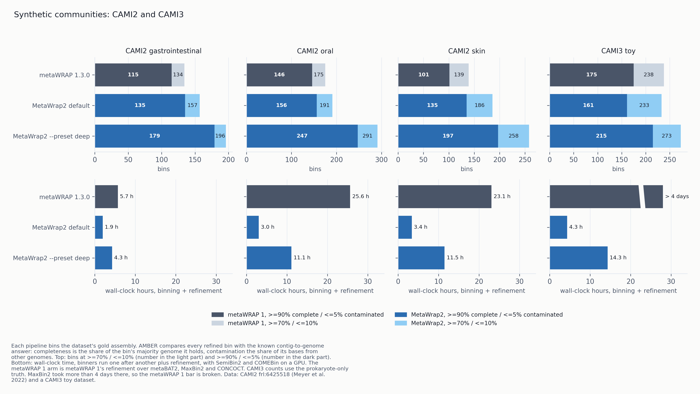

Each pipeline bins the pooled gold assembly of a CAMI2 site (all samples mapped to it) or of the
CAMI3 toy dataset, and AMBER scores the refined set against the gold standard. Per bin,
completeness is the share of its majority genome's bases it holds and contamination the share of
its own bases from other genomes. This contamination is not CheckM's: it counts bases, not
duplicated markers, and cannot exceed 100%.

The metaWRAP 1 column is metaWRAP 1.3.0's `bin_refinement` (CheckM 1.0.18) over the metaBAT2 and
MaxBin2 bin sets that MetaWrap2 made, plus CONCOCT run through MetaWrap2, all from MetaWrap2's
alignments and depth table. It measures metaWRAP 1's refinement and binner set, not its binning
module.

Bins by truth-based quality (CAMI3 against its prokaryote-only truth, since its gold standard also
holds the human host and fungi):

| | metaWRAP 1 | default | `deep` |
|---|---:|---:|---:|
| gastrointestinal, ≥90% / ≤5% | 115 | 135 | 179 |
| gastrointestinal, ≥70% / ≤10% | 134 | 157 | 196 |
| oral, ≥90% / ≤5% | 146 | 156 | 247 |
| oral, ≥70% / ≤10% | 175 | 191 | 291 |
| skin, ≥90% / ≤5% | 101 | 135 | 197 |
| skin, ≥70% / ≤10% | 139 | 186 | 258 |
| CAMI3 toy, ≥90% / ≤5% | 175 | 161 | 215 |
| CAMI3 toy, ≥70% / ≤10% | 238 | 233 | 273 |

bp-weighted F1:

| | metaWRAP 1 | default | `deep` |
|---|---:|---:|---:|
| CAMI2 gastrointestinal | 0.67 | 0.75 | 0.85 |
| CAMI2 oral | 0.36 | 0.39 | 0.53 |
| CAMI2 skin | 0.38 | 0.47 | 0.59 |
| CAMI3 toy | 0.21 | 0.23 | 0.23 |

Purity is 0.98-1.00 throughout, so F1 follows completeness. Wall-clock time (binners one after
another, plus refinement) is in the figure and the README.

### 2.5 Real samples

Four datasets with no known answer, scored with CheckM2 and GUNC. One read QC pass and one assembly
per dataset are shared by all arms.

- Gut and water from the metaWRAP 1 paper: 50 MetaHIT gut and 36 Baltic Sea water samples, one
  MEGAHIT co-assembly each. The metaWRAP 1 arm is metaWRAP 1.3.0's `bin_refinement` over
  metaBAT2, MaxBin2 and CONCOCT bins made through MetaWrap2 on the same co-assemblies, with
  MetaWrap2's depth table.
- One deeply sequenced Hadza gut sample (ERR7745335, published assembly).
- A faecal-transplant series of three samples (one MEGAHIT co-assembly). Final sets for this and the
  Hadza sample were rescored with `metawrap2 score`. On these two, metaWRAP 1.3.0 ran its own
  binning and refinement on the shared assembly.

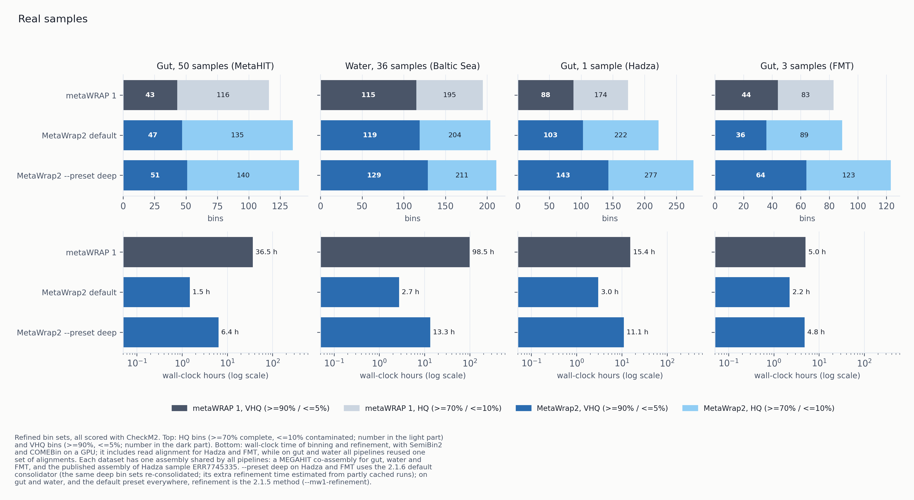

| Clean MAGs (wall-clock time) | Gut, 50 samples | Water, 36 samples | Gut, 1 sample | Gut, 3 samples |
|---|---:|---:|---:|---:|
| metaWRAP 1 | 94 (36.5 h) | 183 (98.5 h) | 158 (15.4 h) | 72 (5.0 h) |
| MetaWrap2 default | 110 (1.5 h) | 184 (2.7 h) | 207 (3.0 h) | 78 (2.2 h) |
| MetaWrap2 `deep` | 125 (6.4 h) | 197 (13.3 h) | 267 (11.1 h) | 115 (4.8 h) |

The `deep` cells for the one- and three-sample gut datasets use the 2.1.6 default consolidator,
from the [consolidator benchmark](#consolidators), which re-consolidated the same `deep` bin sets.
The extra refinement wall time (1.6 h on the single sample, 0.05 h on three samples) is an
estimate: those runs reused some scores, so their time was scaled to the share of candidates scored
fresh. All other cells, and the CAMI tables, were measured with the 2.1.5 consolidator, now
`--mw1-refinement`.

Notes on the one- and three-sample runs:

- metaWRAP 1 kept 186 and 87 bins at `-c 70 -x 10` by its internal CheckM1 scores; 174 and 83 of
  them meet those thresholds under CheckM2.
- metaWRAP 1 aligned the reads itself with bwa instead of reusing MetaWrap2's minimap2 alignments.
  With metaBAT2 on the same three-sample assembly, bwa alignments gave 269 bins and minimap2 gave 288
  (592 and 587 on the single sample).
- Alignment and the depth table took 53.8 minutes on the single sample and 66.6 on three samples.
  Alignment per sample was longer on the single sample (53.8 minutes, against 22 per sample on
  three) because its library is much deeper.
- MaxBin2 inside metaWRAP 1 ran single-threaded for several hours on the single sample. metaWRAP 1
  binning took 14.1 hours there.
- Arms sometimes ran at the same time on one machine, so wall-clock times include some contention.

### 2.6 Refinement speed

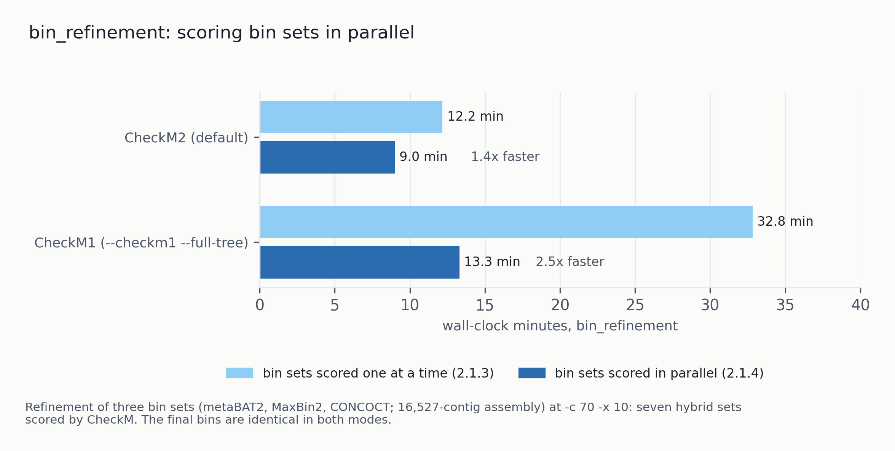

Three-binner refinement with the metaWRAP 1 method (`--mw1-refinement` from 2.1.6; metaBAT2 26,
MaxBin2 21 and CONCOCT 56 bins on a 16,527-contig assembly), `-c 70 -x 10`, seven hybrid sets.

| | one set at a time | sets in parallel | final bins |
|---|---:|---:|---|
| CheckM2 (default) | 730 s | 539 s | identical; one bin's completeness moved by 0.04 |
| CheckM1, full tree (`--checkm1 --full-tree`) | 1,969 s | 798 s | identical, and every stats value identical |

pplacer (64% of CheckM1's time in refinement) holds about 34 GB per process whatever its thread
count, and 23 bins took 184 s at 1 thread, 151 s at 8 and 158 s at 24. Running sets in parallel
uses the machine better than more threads per call. Splitting one set into several CheckM calls was
slower, since each call loads the reference package again.

## 3. Binning

Gold-assembly arms (long, clean contigs), every count after refinement.

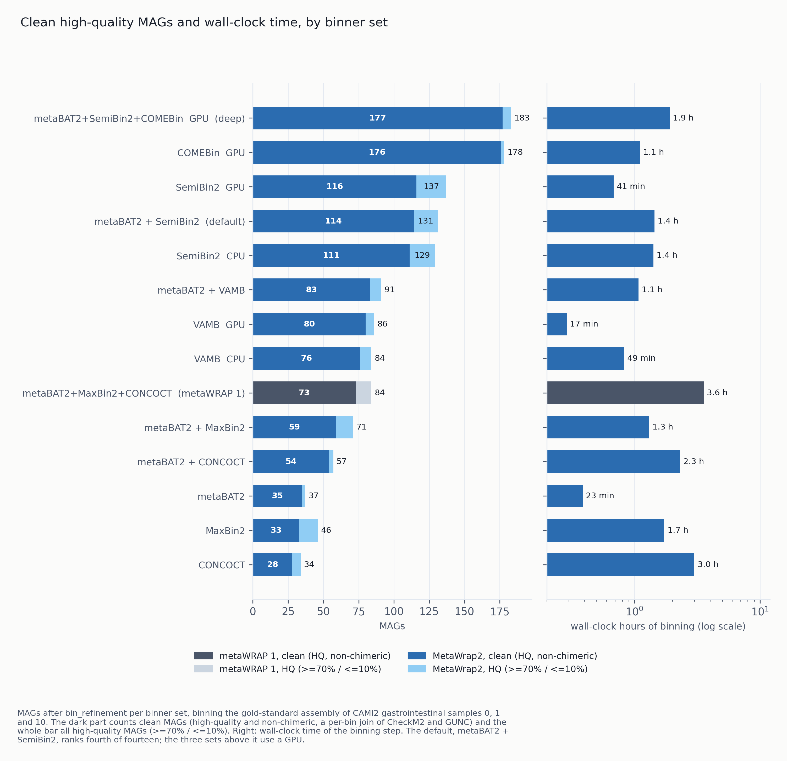

The figure has fourteen arms; metaWRAP 1's trio ranks in the middle. `deep` recovers 1.55× the clean MAGs of `default`
here and 1.13× end to end (§2).

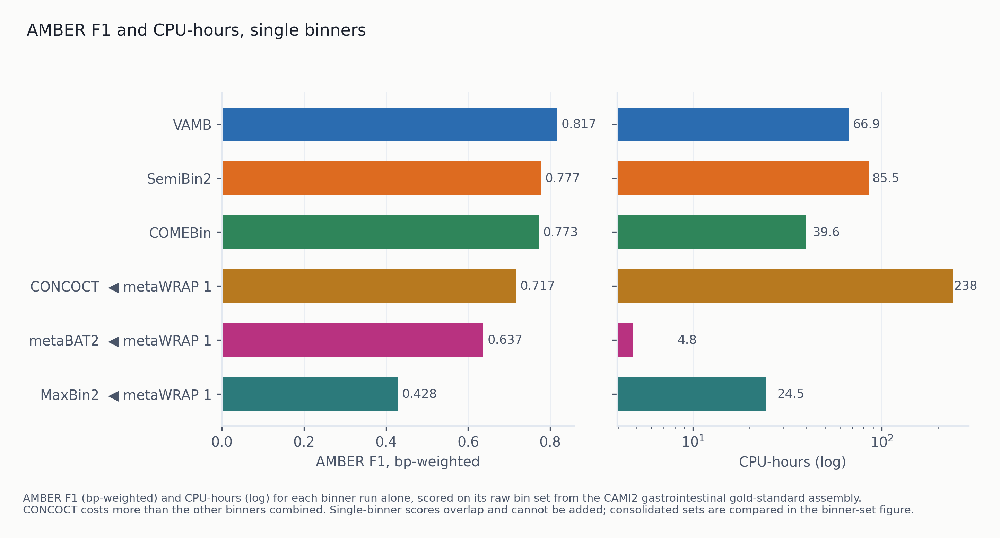

Against the truth table, all three learned binners (VAMB 0.82, SemiBin2 0.78, COMEBin 0.77 F1)
score above all three of metaWRAP 1's (CONCOCT 0.72, metaBAT2 0.64, MaxBin2 0.43). CONCOCT is
third and costs more than all others combined, so it is opt-in.

### `--preset`

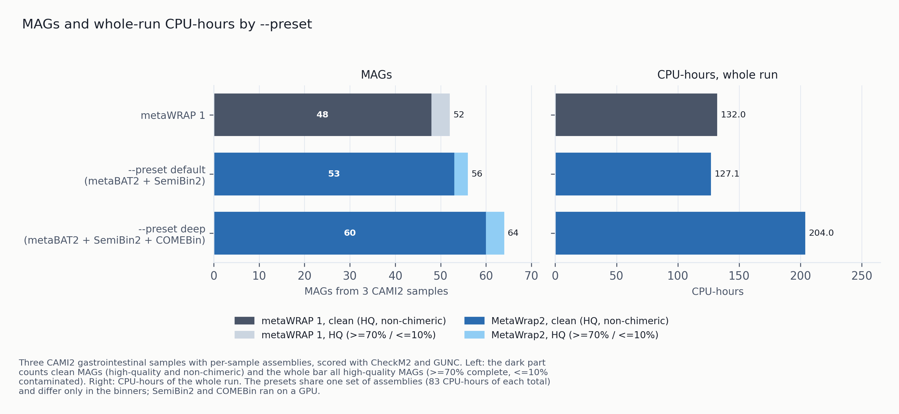

| tier | binners | clean MAGs, end to end | clean MAGs, gold assembly | extra install |
|---|---|---|---|---|
| `default` | metaBAT2 + SemiBin2 | **53** | 114 | `install-env learned` |
| `deep` | metaBAT2 + SemiBin2 + COMEBin | **60** | **177** | `install-env learned` |

- In `default`, metaBAT2 reuses SemiBin2's depth table and costs ~1.3 CPU-hours. On the gold assembly
  the pair gives 114 clean MAGs against SemiBin2's own 116.
- A preset never overrides a binner named explicitly.
- `metawrap2-learned` holds SemiBin2, VAMB and COMEBin with a CUDA-capable pytorch, serving both
  `--device cpu` and `--device cuda`.

### Binner combinations

Each clean high-quality gold-assembly bin was assigned to the reference genome owning most of its
sequence, and unions were taken over pairs and trios.

| binner | clean MAGs | genomes recovered | of those, found by nothing else |
|---|---|---|---|
| COMEBin | 176 | 176 | **39** |
| SemiBin2 | 116 | 116 | 4 |
| VAMB | 80 | 80 | 0 |
| metaBAT2 | 35 | 35 | 0 |
| MaxBin2 | 33 | 33 | 1 |
| CONCOCT | 28 | 28 | 0 |

COMEBin finds most of what the others find. The best pair is COMEBin + SemiBin2 at 181 genomes. The
best trio is COMEBin + SemiBin2 + MaxBin2 (182); COMEBin + SemiBin2 + metaBAT2 reaches 181.

`deep` uses the trio with metaBAT2, one genome short of the best trio. Of the trios within one genome
of the best it is cheaper by an order of magnitude: metaBAT2 costs ~1.5 CPU-hours, against VAMB's 4.9 CPU-hours on a GPU (0.29 hours of wall time), MaxBin2's 24.5 CPU-hours and CONCOCT's
238. It covers three algorithm families: contrastive (COMEBin), self-supervised (SemiBin2) and
composition-plus-coverage (metaBAT2).

The union of 182 assumes refinement picks the right version of every bin. Whether COMEBin's 39 unique
genomes generalise is untested beyond this dataset.

### `--device`

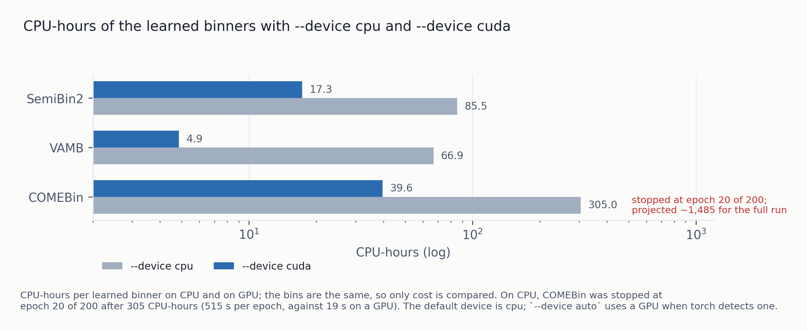

One switch covers all three learned binners; `auto` asks each environment whether torch sees a
device. The default `cpu` gives the same MAGs on any hardware. On a GPU, COMEBin's run on the gold
assembly took 39.6 CPU-hours and 66 minutes of wall time; on a CPU it did not finish.

Run GPU arms with `metawrap2 --gpu-strict benchmark ...` or `[limits] gpu_strict = true`. A step that
shares a card has an inflated wall time and a GPU trace that covers both jobs, so its own GPU cost
cannot be recovered. With `--gpu-strict` the step refuses to start on a busy card.

VAMB refuses to start on the gold assembly because it contains 20 records with no A, C, G, T or U
(masked reference genomes, 28.9 Mbp, the largest 6.6 Mbp). metaBAT2, MaxBin2 and CONCOCT accept such
contigs and cannot place them. `binning` and `coverage` drop them.

## 4. Coverage estimation

MetaWrap2 computes its own depth table with the algorithm of `jgi_summarize_bam_contig_depths`;
means agree with jgi at Pearson 0.9992 across all 210,632 CAMI2 contigs. The invalid MaxBin2 depths
from jgi (§8) were found by comparing two runs of the C++ binary against it.

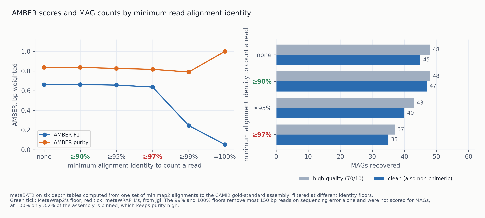

jgi discards reads below 97% alignment identity. On this strain-rich data a 90% floor gives more
complete, purer and less chimeric bins: 47 clean MAGs against 35. AMBER purity and GUNC show no sign of
strains merged through reads from related genomes. The default is 90, the only parameter that differs from jgi;
`--min-identity 97` reproduces a jgi (and metaWRAP 1) table. Measured on one dataset with one binner.

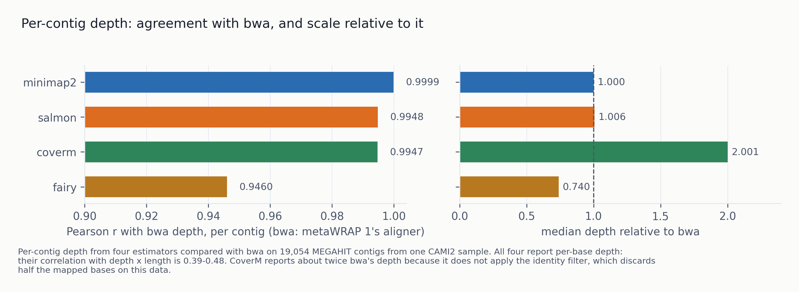

Per contig, CoverM reports 2× bwa's depth because it applies no identity filter, so it cannot
directly replace the depth table.

## 5. Refinement

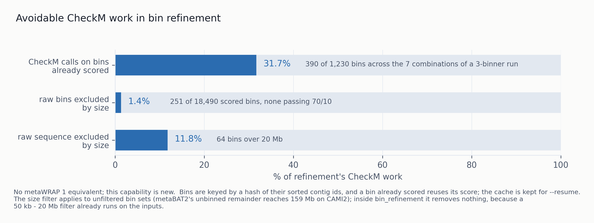

The default consolidator up to 2.1.5, metaWRAP 1's method (`--mw1-refinement` from 2.1.6), hybridises
every combination of its input bin sets and runs CheckM to choose which version of each bin to keep:
2ⁿ−1 CheckM runs. The measurements in this section before [Consolidators](#consolidators) are of
that method. Two kinds of call are skipped without changing any result:

- Bins already scored, identified by a hash of their sorted contig ids: a third of the calls.
- Bins outside 200 kb–20 Mb, which cannot be ≥70%-complete genomes. CheckM's cost scales with bases,
  and metaBAT2's unbinnable remainder reaches 159 Mb. `--score-everything` disables this filter.

GUNC runs on every final bin set by default. On one arm, 4 of 60 final bins pass CheckM at 70/10 and are chimeric by GUNC; the two input
bin sets were 12.0% and 36.0% chimeric and the consolidated set 6.7%. GUNC annotates bins and does
not drop them. `--skip-gunc` opts out, along with its 6.7 GB database.

`--consolidator dastool` scores input bins once on single-copy genes instead of running CheckM on every
combination. On one sample, the metaWRAP 1 method keeps 13 MAGs for 4.52 CPU-hours and DAS Tool keeps
10 for 0.62.

The default from 2.1.6, `--consolidator metawrap2`, adds unions and differences of overlapping input
bins to the intersections and keeps a derived bin only if it outscores the original bins and
intersections it would block (see [Consolidators](#consolidators)).

### Consolidators

Seven consolidation arms, each given the same input: the metaBAT2, SemiBin2 and COMEBin bin sets
of `--preset deep` and the assembly they came from. Input bins outside 200 kb–20 Mb were removed
for every arm, the window `bin_refinement` applies internally. For the clean HQ tables, arms with
quality thresholds ran at `-c 70 -x 10` or its equivalent; DAS Tool and MAGScoT kept their own
scoring defaults. Every arm with thresholds was also run at 90/5 for the near-complete table.

| arm | tool |
|---|---|
| MetaWrap2 | MetaWrap2 `bin_refinement`, the 2.1.6 default (`--consolidator metawrap2`): intersections, unions and differences over cliques of overlapping bins, lookahead guard, contamination weight 5, CheckM2 |
| metaWRAP 1.3.0 | metaWRAP 1.3.0 `bin_refinement` (CheckM 1.0.18) |
| `--consolidator dastool` | MetaWrap2 `bin_refinement --consolidator dastool` |
| DAS Tool | DAS Tool 1.1.7 |
| Binette | Binette 1.2.1 |
| MAGScoT | MAGScoT (commit 0b561ef) |
| UniteM | UniteM 1.2.6, greedy |

Datasets: the pooled gold assemblies of CAMI2 gastrointestinal, oral and skin and of the CAMI3 toy
dataset (§2.4), one deeply sequenced Hadza gut sample (ERR7745335, published assembly) and a
three-sample faecal-transplant series (PRJNA701961, one MEGAHIT co-assembly). Every arm's output
was rescored with the same CheckM2, GUNC and MIMAG tagging; no tool's own scores are used. Cost is
CPU-hours of the whole path from bin sets and assembly to the final set, including each tool's own
gene prediction and marker search. Arms ran at the same time on one large shared server, so wall
time is not compared. One run per arm.

The MetaWrap2 arm ran the algorithm as a standalone implementation, scored with CheckM2, before it
was moved into `bin_refinement`. The `--consolidator dastool` arm ran development code based on
2.1.3 (see the end of this section). Binette orders equally scored candidates by a key that depends
on the Python hash seed (`PYTHONHASHSEED`), so its counts are one draw each; in three runs on the
same input its candidate pool had the same size and the labels of one or two candidates changed.

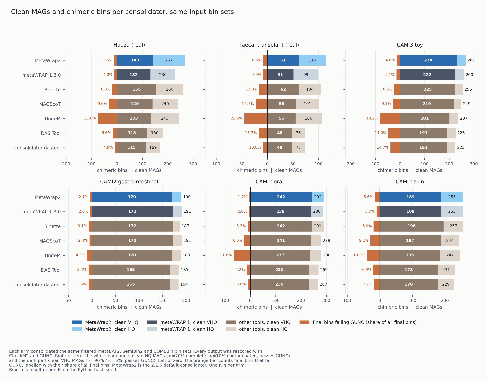

Clean HQ MAGs:

| | CAMI2 gastrointestinal | CAMI2 oral | CAMI2 skin | CAMI3 toy | Hadza | faecal transplant |
|---|---:|---:|---:|---:|---:|---:|
| MetaWrap2 | 190 | 292 | 255 | 267 | 267 | 115 |
| metaWRAP 1.3.0 | 191 | 286 | 255 | 260 | 230 | 99 |
| `--consolidator dastool` | 184 | 267 | 229 | 225 | 169 | 73 |
| DAS Tool | 185 | 269 | 231 | 226 | 180 | 73 |
| Binette | 187 | 291 | 257 | 255 | 260 | 104 |
| MAGScoT | 191 | 279 | 244 | 249 | 240 | 101 |
| UniteM | 189 | 280 | 247 | 237 | 243 | 106 |

Clean VHQ MAGs (≥90% complete, ≤5% contaminated, passes GUNC) in the same 70/10 runs; the
near-complete table further down uses runs at 90/5:

| | CAMI2 gastrointestinal | CAMI2 oral | CAMI2 skin | CAMI3 toy | Hadza | faecal transplant |
|---|---:|---:|---:|---:|---:|---:|
| MetaWrap2 | 170 | 242 | 189 | 230 | 143 | 61 |
| metaWRAP 1.3.0 | 172 | 239 | 189 | 222 | 132 | 51 |
| `--consolidator dastool` | 165 | 230 | 178 | 191 | 115 | 48 |
| DAS Tool | 165 | 230 | 178 | 191 | 118 | 48 |
| Binette | 172 | 242 | 196 | 225 | 155 | 62 |
| MAGScoT | 172 | 241 | 187 | 219 | 140 | 56 |
| UniteM | 170 | 237 | 185 | 201 | 133 | 55 |

CPU-hours:

| | CAMI2 gastrointestinal | CAMI2 oral | CAMI2 skin | CAMI3 toy | Hadza | faecal transplant |
|---|---:|---:|---:|---:|---:|---:|
| MetaWrap2 | 26.7 | 46.6 | 51.7 | | | |
| metaWRAP 1.3.0 | 48.6 | 69.9 | 72.9 | 82.3 | 21.8 | 18.5 |
| `--consolidator dastool` | 8.0 | 12.7 | 12.2 | 15.5 | 6.1 | 2.7 |
| DAS Tool | 1.4 | 2.5 | 2.4 | 6.0 | 2.3 | 0.9 |
| Binette | 2.2 | 3.0 | 3.1 | 4.5 | 2.8 | 1.4 |
| MAGScoT | 1.5 | 2.3 | 2.2 | 5.3 | 2.2 | 0.9 |
| UniteM | 4.7 | 6.7 | 6.9 | 10.9 | 5.8 | 2.6 |

A blank cell was not measured cleanly: on those datasets the MetaWrap2 arm reused CheckM2 scores of
candidates that an earlier development arm on the same bin sets had scored. On CAMI2 it scored
2,177, 6,588 and 6,289 candidates for 26.7, 46.6 and 51.7 CPU-hours, with a peak memory of
15-16 GB. That is less than metaWRAP 1.3.0 (48.6, 69.9 and 72.9) and 12-17x Binette (2.2-3.1).
CheckM2 predicts genes and runs DIAMOND on each candidate bin separately, so a contig shared by many
candidates is processed many times. Binette predicts genes and runs DIAMOND once over the assembly,
builds each candidate's CheckM2 features by summing per-contig counts and runs the CheckM2 models
in process; in a wall-time comparison on the faecal-transplant series this was about 17 times
faster per candidate. The 90/5 run of MetaWrap2 scores the same candidates as the 70/10 run.

Final bins, and of those the bins that fail GUNC:

| | CAMI2 gastrointestinal | CAMI2 oral | CAMI2 skin | CAMI3 toy | Hadza | faecal transplant |
|---|---:|---:|---:|---:|---:|---:|
| MetaWrap2 | 194 / 4 | 297 / 5 | 270 / 15 | 280 / 13 | 277 / 10 | 123 / 8 |
| metaWRAP 1.3.0 | 197 / 4 | 299 / 6 | 272 / 10 | 277 / 14 | 251 / 10 | 114 / 8 |
| `--consolidator dastool` | 193 / 7 | 281 / 10 | 249 / 18 | 266 / 39 | 183 / 9 | 83 / 9 |
| DAS Tool | 208 / 7 | 336 / 14 | 288 / 20 | 336 / 47 | 241 / 16 | 102 / 17 |
| Binette | 193 / 6 | 301 / 10 | 277 / 19 | 279 / 24 | 281 / 19 | 120 / 16 |
| MAGScoT | 206 / 5 | 368 / 24 | 319 / 29 | 319 / 29 | 332 / 32 | 138 / 23 |
| UniteM | 235 / 10 | 568 / 66 | 389 / 39 | 451 / 82 | 550 / 76 | 200 / 45 |

The same as a share of final bins failing GUNC:

| | CAMI2 gastrointestinal | CAMI2 oral | CAMI2 skin | CAMI3 toy | Hadza | faecal transplant |
|---|---:|---:|---:|---:|---:|---:|
| MetaWrap2 | 2.1% | 1.7% | 5.6% | 4.6% | 3.6% | 6.5% |
| metaWRAP 1.3.0 | 2.0% | 2.0% | 3.7% | 5.1% | 4.0% | 7.0% |
| `--consolidator dastool` | 3.6% | 3.6% | 7.2% | 14.7% | 4.9% | 10.8% |
| DAS Tool | 3.4% | 4.2% | 6.9% | 14.0% | 6.6% | 16.7% |
| Binette | 3.1% | 3.3% | 6.9% | 8.6% | 6.8% | 13.3% |
| MAGScoT | 2.4% | 6.5% | 9.1% | 9.1% | 9.6% | 16.7% |
| UniteM | 4.3% | 11.6% | 10.0% | 18.2% | 13.8% | 22.5% |

In these 70/10 runs MetaWrap2 has a lower share of bins failing GUNC than Binette, MAGScoT, UniteM
and DAS Tool on every dataset, and the lowest of all seven arms on CAMI2 oral, CAMI3 toy, Hadza and
the faecal-transplant series. metaWRAP 1.3.0 is lower on CAMI2 gastrointestinal (2.0% against
2.1%) and skin (3.7% against 5.6%). MAGScoT here ran at its own default thresholds; a MAGScoT run
at 70/10 had 4.5% failing on Hadza (10 of 221), against 3.6% for MetaWrap2. At 90/5 MAGScoT is
cleaner on two CAMI2 datasets (see the near-complete table below).

Mean rank by clean HQ MAGs over the six datasets (1 is best; tied arms share the better rank).
The per-dataset ranks are in the column order of the tables above:

| arm | mean rank | ranks per dataset |
|---|---:|---|
| MetaWrap2 | 1.50 | 3, 1, 2, 1, 1, 1 |
| Binette | 2.67 | 5, 2, 1, 3, 2, 3 |
| metaWRAP 1.3.0 | 3.00 | 1, 3, 2, 2, 5, 5 |
| UniteM | 3.67 | 4, 4, 4, 5, 3, 2 |
| MAGScoT | 3.83 | 1, 5, 5, 4, 4, 4 |
| DAS Tool | 6.00 | 6, 6, 6, 6, 6, 6 |
| `--consolidator dastool` | 6.83 | 7, 7, 7, 7, 7, 6 |

Head to head on clean HQ MAGs, MetaWrap2's wins-losses-ties over six datasets:

| against | MetaWrap2 |
|---|---|
| metaWRAP 1.3.0 | 4-1-1 |
| Binette | 5-1-0 |
| MAGScoT | 5-1-0 |
| UniteM | 6-0-0 |
| DAS Tool | 6-0-0 |
| `--consolidator dastool` | 6-0-0 |

**MetaWrap2.** On the two real datasets it recovered more clean HQ MAGs than any other arm: 267 on
Hadza against 260 for Binette and 230 for metaWRAP 1.3.0, and 115 on the faecal-transplant series
against 106 for UniteM and 99 for metaWRAP 1.3.0. It also recovered the most on CAMI2 oral (292)
and CAMI3 toy (267). It was second on CAMI2 skin (255 against 257 for Binette) and third on
gastrointestinal (190 against 191 for metaWRAP 1.3.0 and MAGScoT). Binette has the most clean VHQ
MAGs in the 70/10 runs on Hadza (155) and CAMI2 skin (196).

Unions and differences, measured by turning them off (intersections only, the same selection and
weight 5):

| | CAMI2 gastrointestinal | CAMI2 oral | CAMI2 skin | CAMI3 toy | Hadza | faecal transplant |
|---|---:|---:|---:|---:|---:|---:|
| MetaWrap2 | 190 | 292 | 255 | 267 | 267 | 115 |
| intersections only | 188 | 289 | 254 | 267 | 258 | 111 |
| difference | +2 | +3 | +1 | 0 | +9 | +4 |

The lookahead guard and iterating the candidate building over several rounds were tested during
development; the guard ships and iteration does not.

**Near-complete MAGs.** `-c`/`-x` are the target a consolidator selects for, so a near-complete
count read off a 70/10 run measures a target the tool was not given. Every tool was therefore run
again at 90/5 in its own units (`-c 90 -x 5`; Binette `--min_completeness 90
--max_contamination 5`; UniteM `-x 90 -y 5`; MAGScoT `-t 0.9 --max_cont 0.05`) and scored for clean
VHQ MAGs. MAGScoT was also run at 70/10 (`-t 0.7 --max_cont 0.10`), so it has three runs. Each cell
below is the better of that tool's runs, and the run is given. The MetaWrap2 row is its 90/5 run.

| clean VHQ MAGs | CAMI2 gastrointestinal | CAMI2 oral | CAMI2 skin | CAMI3 toy | Hadza | faecal transplant |
|---|---:|---:|---:|---:|---:|---:|
| MetaWrap2, 90/5 | 173 | 247 | 193 | 233 | 153 | 63 |
| metaWRAP 1.3.0, 70/10 [b] | 172 | 239 | 189 | 222 | 132 | 51 |
| `--consolidator dastool`, 70/10 [b] | 165 | 230 | 178 | 191 | 115 | 48 |
| DAS Tool [a] | 165 | 230 | 178 | 191 | 118 | 48 |
| Binette | 173 (90/5) | 242 (90/5) | 196 (70/10) | 226 (90/5) | 155 (70/10) | 62 (70/10) |
| MAGScoT [b] | 172 (defaults) | 241 (defaults) | 190 (70/10) | 220 (70/10) | 140 (defaults) | 56 (defaults) |
| UniteM | 170 (90/5) | 237 (90/5) | 185 (90/5) | 201 (90/5) | 133 (90/5) | 55 (70/10) |

- [a] DAS Tool has no completeness or contamination threshold, so its one run is in both tables.
- [b] A run at a looser target recovered more clean VHQ MAGs than the 90/5 run. For MAGScoT and
  UniteM the thresholds are a hard filter applied to the selected bins, not a selection target, so
  a stricter threshold removes genomes instead of choosing different versions of them: MAGScoT at
  90/5 kept 30 clean VHQ MAGs on the faecal-transplant series against 56 at its defaults. UniteM's
  two runs gave the same bin counts on every dataset.

MetaWrap2 recovered the most clean VHQ MAGs on the faecal-transplant series (63 against 62 for
Binette), CAMI3 toy (233 against 226) and CAMI2 oral (247 against 242), tied with Binette on CAMI2
gastrointestinal (173), and was second on Hadza (153 against 155 for Binette) and CAMI2 skin (193
against 196). Against its own 70/10 run it gained on every dataset: 143 to 153 on Hadza, 61 to 63
on the faecal-transplant series, 242 to 247 on oral, 170 to 173 on gastrointestinal, 189 to 193 on
skin and 230 to 233 on CAMI3 toy.

Share of final bins failing GUNC in the 90/5 runs:

| | CAMI2 gastrointestinal | CAMI2 oral | CAMI2 skin | CAMI3 toy | Hadza | faecal transplant |
|---|---:|---:|---:|---:|---:|---:|
| MetaWrap2 | 1.7% (3 / 176) | 1.6% (4 / 251) | 4.9% (10 / 203) | 4.5% (11 / 244) | 1.3% (2 / 155) | 6.0% (4 / 67) |
| metaWRAP 1.3.0 | 1.7% (3 / 180) | 2.4% (6 / 254) | 3.8% (8 / 212) | 4.8% (12 / 251) | 3.2% (5 / 155) | 7.9% (5 / 63) |
| Binette | 2.8% (5 / 178) | 3.2% (8 / 251) | 4.9% (10 / 204) | 8.1% (20 / 247) | 4.4% (7 / 159) | 10.1% (7 / 69) |
| MAGScoT | 0.6% (1 / 168) | 2.5% (6 / 240) | 2.6% (5 / 192) | 5.4% (11 / 203) | 2.2% (2 / 93) | 15.0% (6 / 40) |
| UniteM | 4.3% (10 / 235) | 11.6% (66 / 568) | 10.0% (39 / 389) | 18.2% (82 / 451) | 13.8% (76 / 550) | 23.0% (46 / 200) |

At 90/5 MAGScoT's runs on CAMI2 gastrointestinal (0.6% against 1.7%) and skin (2.6% against 4.9%)
have a lower share failing GUNC than MetaWrap2, at comparable bin counts (168 against 176, 192
against 203); MetaWrap2 recovers 11 and 15 more clean VHQ MAGs there (173 against 162, 193 against
178). metaWRAP 1.3.0's 90/5 run is also lower on CAMI2 skin (3.8%).

**metaWRAP 1's method is subtractive.** Binning_refiner keeps a contig in a hybrid set only when
every input set it combines has the contig in a bin, and groups contigs by the bins they share, so
every candidate is an input bin or an intersection of input bins. On all six datasets every final
bin of metaWRAP 1.3.0 is a subset of one input bin, and none holds a contig that no input bin had
(between 85 and 226 final bins per dataset are an input bin unchanged). No final bin can hold more
of a genome than the input bin it came from. Binette and MetaWrap2 also build unions, which can
hold more of a genome than any one input bin.

**MAGScoT and UniteM** return more bins than MetaWrap2 and Binette on every dataset, and more of
their bins fail GUNC: on CAMI3 toy 29 (MAGScoT) and 82 (UniteM), against 13 for MetaWrap2. Neither
recovers more clean HQ MAGs than MetaWrap2 on any dataset except MAGScoT on CAMI2
gastrointestinal (191 against 190).

**`--consolidator dastool`** costs 2.6–5.5x the CPU-hours of DAS Tool run on its own (2.57x on
CAMI3 toy, 5.55x on CAMI2 gastrointestinal). MetaWrap2 skips hybridisation and the per-set CheckM
runs for this consolidator, but prepares the inputs and scores the consolidated set with CheckM,
here CheckM1 on the full tree (peak memory 36.8–37.4 GB). It recovered as many or fewer clean HQ
MAGs than DAS Tool alone on every dataset: 169 against 180 on Hadza, 73 against 73 on the
faecal-transplant series, and 1 or 2 fewer on CAMI.

The `--consolidator dastool` arm ran development code based on 2.1.3, whose default scorer was
CheckM1 on the full genome tree; in this release that is `--checkm1 --full-tree`, and `--checkm1`
alone uses the reduced tree.

## 6. Bin abundance

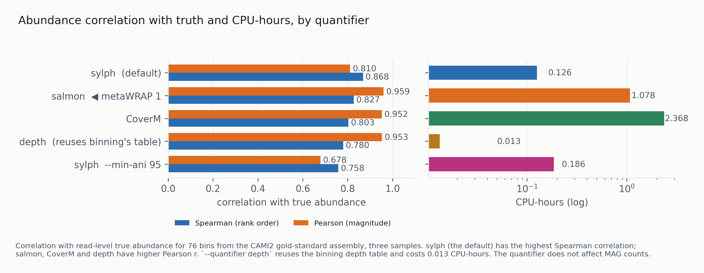

metaWRAP 1 uses salmon. MetaWrap2 offers four quantifiers and defaults to sylph, which ranks bins
best and estimates magnitude worst; salmon is the reverse. sylph is the default because most
abundance tables are used for ranking.

`--quantifier depth` aligns nothing: it takes a length-weighted mean per bin from the depth table
binning already wrote, the same values the binner clustered on. It costs 0.013 CPU-hours, 180× less
than CoverM, and ranks second of four on magnitude and last on ordering.

Values are not interchangeable across quantifiers:

- salmon reports a length-weighted median contig coverage, CoverM a percentage of the sample, sylph a
  k-mer sequence abundance.
- A CoverM zero means "mapped, but under `--min-covered-fraction` covered"; a sylph zero means "not
  detected above `--min-ani`".
- MetaWrap2 sets sylph's `--min-ani` to 99 instead of sylph's default 95. At 95, more than half the
  abundance in one sample went to four bins whose genomes are absent from it.

## 7. Smaller changes

- `read_qc` trims with fastp: 0.83% more bases and 0.4% more Q30 bases kept for 5.8% less CPU
  (cutadapt stops scaling at 4 threads). Trim Galore remains supported and peaks at 0.1 GB of memory
  against fastp's 1.4.
- `reassemble_bins --max-coverage` (default 50) thins each bin's recruited reads to 50× of its
  assembled length, in pairs, with a fixed seed, since SPAdes' time grows with reads. `0` keeps every
  read.
- `blobology` no longer uses bowtie2. `--aligner` offers binning's three choices from one shared
  registry.
- `mw2` is the same CLI under a shorter name.
- Nine conda environments; modules that run in sequence and share tools share one. Four are separate:
  CheckM2 has no common solution with CheckM1 + GUNC + DAS Tool, nor GTDB-Tk with taxator-tk. GUNC, DAS Tool,
  CoverM, fairy and Bakta are installed by default.
- All two dozen entry points print defaults and accepted values from one formatter, read off the
  parser. A numeric option declares its range once: `-c/--completeness` reads
  `[0-100] [default: 70]` and rejects `-5`.

## 8. Defects found and fixed

Each produced wrong numbers or lost runs without an error, and each has a regression test.

Pipeline:

- MaxBin2 binned on values from `jgi_summarize_bam_contig_depths --noIntraDepthVariance` that are not
  depths, affecting every bin it produced.
- An all-N contig broke VAMB and was binned by everything else.
- Four modules treated the unbinned leftovers as a candidate genome.
- `--resume` on `bin_refinement` deleted the output it was resuming from and reported success; the same
  two defects were in `reassemble_bins`.
- metaBAT2 had no seed, so identical input did not reproduce.
- A crashed aligner read as a successful run.
- With one input bin set nothing applied the quality thresholds: refining a single COMEBin run left 376
  bins in `metawrap_70_10_bins`, of which 178 pass.
- `reassemble_bins` recruited reads that are not reads and scored unknowns as perfect.
- A study sheet selecting any `--preset` without MaxBin2 failed at refinement: the driver resolved binner
  flags but not presets, and passed refinement two directories that were never created.

Harness:

- No multi-binner arm had been ranked: refinement writes into a subdirectory and the scanner only read
  the variant root.
- A re-score that changed an arm's bin set was added to the old one, so COMEBin's 178 MAGs read as 356.
- Clean-MAG counts were estimated as `HQ × GUNC pass fraction`, which understated COMEBin by 18 genomes
  and reversed a default.
- `benchmark score` run from outside the repository wrote a second results file and reported success.
- AMBER scored one bin set twice as two arms, and was skipped on any variant already through CheckM.
- The ranker summed fractions, so the variant measured on the most samples won.

Found in a later harness review. The first, second and fourth change numbers in the committed
results table, and the affected sections need re-scoring.

- `read_qc` figures are one mate's count: measurements are keyed on (dataset, comparison, variant,
  sample, metric), so the per-mate rows collapsed to the last mate. `reads_kept`, `bases_kept` and
  `q30_bases_kept` in §7 are half the real counts; both arms are halved, so the 0.83%/0.4% margins hold.
- A refinement arm used only three of its bin sets, alphabetically: the runner zipped the bin
  directories onto `("-A", "-B", "-C")`, and `zip` truncates. With
  `comebin/concoct/maxbin2/metabat2/semibin2/vamb` that drops metaBAT2. It also fed a previous
  refinement's output back in as an input set. Refinement arms above four binners need re-running;
  the arms in §5 use two.
- A crashed variant's partial output was scored and published with cost "unmeasured", like a finished
  arm whose rusage was lost. Failed variants are now skipped; `--score-failed` overrides.
- Abundance was scored over the intersection of table and truth, so a quantifier that omitted a bin
  was scored on fewer bins (the salmon path writes only rows salmon emitted; the CoverM path pre-seeds
  one per bin). Missing bins now count as zero and are reported as `abundance_missing_bins`. §6's
  ordering result needs re-scoring; the sylph-salmon gap is wide enough that it is unlikely to reverse.
- `samtools view | samtools depth` could deadlock: both stderr pipes went unread until the depth
  stream was consumed, and one warning per record fills the 64 KiB buffer, hanging the run with no
  output and no timeout. Both pipes are now drained concurrently.
- The disk monitor interrupted the main thread without re-checking whether the watched step had
  finished, so under `run` or `cohort` the `KeyboardInterrupt` could land in the next step, which was
  reported as a disk stop.

## 9. Limitations

Everything except §2.1 to §2.5 and the consolidator comparison in §5 is CAMI2 gastrointestinal,
mostly three samples. The identity floor
most needs re-testing elsewhere; it should matter less on self-assembled contigs, whose fragmented
consensus already absorbs some strain variation.

Open issues:

- CONCOCT costs ~4× more under MetaWrap2 than under metaWRAP 1 for the same version and flags, on
  assemblies agreeing to one contig in 19,054. Capping each forked worker's OpenBLAS to one thread
  recovered 1.3×. The next candidate is the build (Python 3.12 and scikit-learn 1.9 against Python
  2.7 and a much older scikit-learn). CONCOCT is opt-in.
- `metabat2_comebin`, the cheap half of the three-binner ensemble, is unmeasured.
- A dereplication comparison needs a scorer that does not exist.
- The cohort-scaling experiment for co-assembly has not been run.
- MetaDecoder and binny are not started.

Open decisions:

1. A different default on GPU machines. VAMB on a GPU beats the default tier on every axis including
   cost, and COMEBin on a GPU gives the best catalogue measured; most users have no GPU.
2. The identity floor, moved on one dataset and revertible in one line. Its denominator is `qlen`,
   which counts soft-clipped and inserted bases where jgi uses the aligned length, so the effective
   floor is looser than requested. Given Pearson 0.9992 on means the aggregate effect is small, but
   tightening it moves every depth table and needs re-measuring.

The test suite passes, ruff, black, isort and mypy are clean over 91 source files, and `doctor` reports
12/12 modules healthy.
