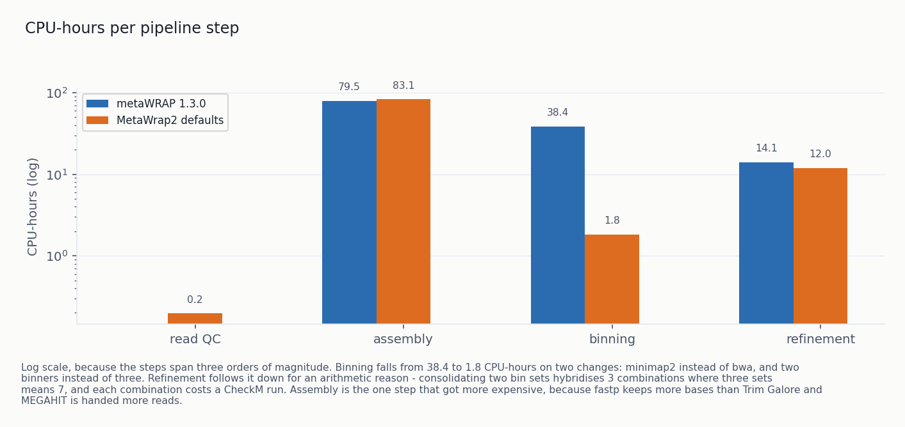
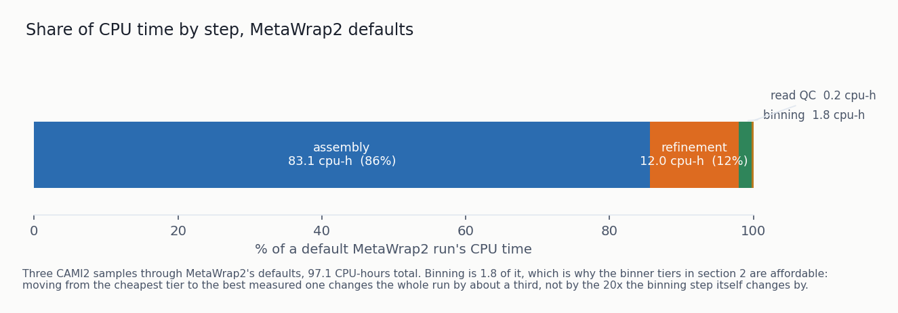
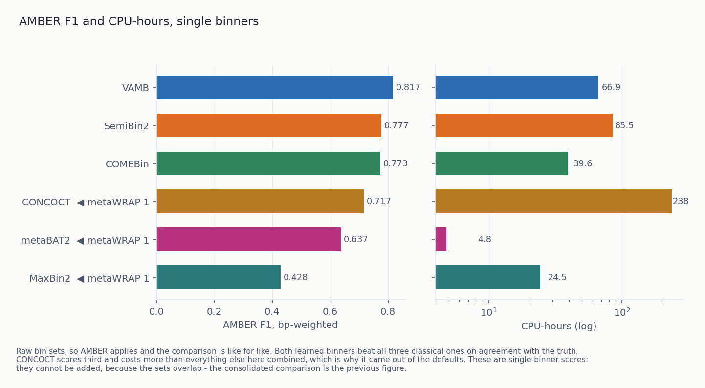
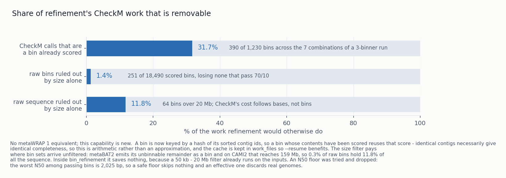
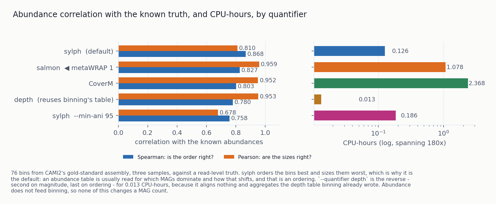

# MetaWrap2: new capabilities, measured against metaWRAP 1

MetaWrap2 is a Python-native rewrite of metaWRAP. This document covers what it can do that metaWRAP 1
cannot, and what each of those capabilities is worth when measured. metaWRAP 1.3.0 is the baseline
throughout.

| | metaWRAP 1.3.0 | MetaWrap2 |
|---|---|---|
| cohort runs | one sample at a time, by hand | `run` / `cohort` from a sheet, resumable per step |
| cross-sample coverage | none | `coverage`: one depth table, N alignments instead of N² |
| dereplication | none | `dereplicate`: a cohort's bins collapsed to organisms |
| binners | metaBAT2, MaxBin2, CONCOCT | those three plus SemiBin2, VAMB, COMEBin, GPU-capable |
| which binners run | one fixed set | four `--preset` tiers, 35 to 176 clean MAGs |
| depth table | `jgi_summarize_bam_contig_depths` | own implementation; identity floor measured and moved |
| chimera detection | none | GUNC on every final bin set, on by default |
| consolidation | CheckM on every combination | same, minus repeat and ruled-out calls |
| bin abundance | salmon | sylph default, four quantifiers measured |
| read capping for reassembly | none | `--max-coverage`, default 50× |
| defaults chosen by | the author | `metawrap2 benchmark`, results committed |
| install | one env, manual | 9 workflow envs, `install-env` / `install-db` / `doctor` |

---

# Methods

**Data.** CAMI2 human microbiome challenge, gastrointestinal, short read. Three samples (0, 1, 10) unless
stated. CAMI2 ships a pooled gold-standard assembly and a contig-to-genome truth table, which is what
makes both designs below possible.

**Two designs, not interchangeable.**

*End-to-end arms* give each pipeline the same raw reads and let it assemble its own. This answers "what
does a user get", and it is how metaWRAP 1 is compared. AMBER cannot score these: its truth is written
against CAMI2's pooled gold assembly and self-assembled contig names appear nowhere in it.

*Binner arms* bin the gold assembly directly. This isolates the binner from an assembler's variance and
allows AMBER. Costs and MAG counts from the two designs are not comparable, and no figure here mixes them.

**Quality.** Bins are scored by CheckM2 into MIMAG tiers — near-complete ≥90% complete / ≤5%
contaminated, high-quality ≥70/≤10 — and by GUNC for chimerism. The headline metric is **clean
high-quality MAGs: bins that are both ≥70/≤10 and non-chimeric**, counted by joining the two reports per
bin. It is deliberately not the product of an HQ count and a pass fraction: GUNC runs per bin set, so a
pass rate measured over raw binner output is diluted by bins that were never candidates, and multiplying
by it understated one arm by 18 genomes.

Every arm of a comparison is scored by the *same* CheckM2 and GUNC. metaWRAP 1 refines with CheckM 1.0.18,
which does not report the same completeness for the same genome, so letting each arm report its own
numbers would compare the scorers rather than the pipelines.

Where AMBER applies it contributes bp-weighted F1, purity and completeness against the truth table. AMBER
purity is bp-weighted, so a bin that is 95% one genome and 5% another barely registers; it is reported
alongside GUNC, never instead of it.

**Cost.** CPU-hours, measured by reaping the child with `os.wait4`. Never wall time, which rewards a tool
for being given more cores. A module run outside the harness produces bins and no cost, so it is not a
measurement. Cost is reported beside quality and never divided into it: a quality-per-cost ratio is
dominated by whichever arm is cheapest, and ranking on one produced a default that recovers fewer genomes
than metaWRAP 1 does.

**Harness.** `metawrap2 benchmark list|fetch|run|score`. Comparisons are declared as data in
`benchmarks/configurations.toml`, so adding an arm is a TOML entry; results land in a committed TSV, so a
moved default arrives in review next to the numbers that justify it. `fetch` is checksum-verified, never
implicit, and refuses to cross a disk ceiling.

**Baseline.** metaWRAP 1.3.0 from its own conda environment at the versions its recipe pins: metaBAT2
2.12.1, MaxBin2 2.2.5, CheckM 1.0.18, bwa 0.7.18, Python 2.7.15.

---

# Results

## 1. Cohort support

metaWRAP 1 processes one sample at a time. Running a study means driving it per sample by hand, and
nothing in it knows that two samples belong to the same experiment. MetaWrap2 adds three pieces that
together make a cohort a first-class input. This is the largest functional gap between the two.

**`metawrap2 run` / `cohort`** take a study sheet — samples, read paths, which steps to run, per-module
options — and execute it. State is a per-step manifest fingerprinted on inputs, so `--resume` restarts
exactly the steps whose inputs changed and skips the rest. A 90-CPU-hour study that dies in refinement
resumes at refinement.

**`metawrap2 coverage`** is the substantive one. Binning a cohort well needs each contig's depth in
*every* sample, because cross-sample covariance is what separates two genomes at similar abundance in any
one sample. Done naively that is N² alignments; this module does N and writes one table every binner
reads.

The comparison that matters is the top two bars, and it is a fair fight: both give the binner a depth
table with one column per sample. **Co-assembly with every sample's coverage is metaWRAP 1's standard
cohort workflow** — co-assemble, align each sample back, bin once — so that is the baseline rather than a
strawman.

| | clean MAGs | near-complete | genomes | CPU-h |
|---|---|---|---|---|
| co-assembly, 3 coverages *(metaWRAP 1's workflow)* | 34 | 18 | 43 | 85.1 |
| per-sample assembly, 3 coverages *(`coverage`)* | 34 | **23** | **46** | 90.9 |

**The two are level on clean high-quality MAGs; the gain is at the stricter tier** — 23 near-complete
against 18, and 46 organisms against 43, for 7% more CPU. Per-sample assembly also keeps each sample's
bins attributable to that sample, which a co-assembly cannot.

The scaling argument favours cross-sample and is undemonstrated: co-assembly's assembler sees 3× the reads
here and would see 20× at twenty samples, where it is expected to fail on memory rather than merely cost
more. Until that is run, co-assembly stays a reasonable choice at small cohort sizes, and `coassemble =
true` in a sheet is how to ask for it.

The figure's bottom bar is an **ablation, not a design**: one coverage column instead of three. Nobody
with three samples would run it, and it is there only because it is the one thing that shows what the
cross-sample table buys — 34 clean MAGs against 29, and 23 near-complete against 19. The mechanism is
visible per step: building the table costs 2.26 CPU-hours and hands 1.2 back, because binning then reads
a table instead of aligning.

The alignment-free route (fairy sketches instead of alignments) makes the coverage step 53× cheaper and
loses 13 of 34 clean MAGs. The step it accelerates is 2.5% of the pipeline. It stays available as
`--coverage fairy` and is not the default.

**`metawrap2 dereplicate`** collapses a cohort's per-sample bin sets into one catalogue of organisms, so
counts mean genomes rather than bins. Every cohort figure here is post-dereplication for that reason.

## 2. Against metaWRAP 1, end to end

| arm | high-quality | clean | CPU-h *(binning + refinement)* | GPU-h |
|---|---|---|---|---|
| `--preset very-fast` | 39 | 36 | **8.8** | — |
| `--preset fast` | 45 | 41 | 13.8 | — |
| **metaWRAP 1.3.0** | **52** | **48** | **52.5** | — |
| `--preset default` *(shipped)* | 56 | **53** | **43.8** | 0.8 |
| `--preset slow` | 61 | **57** | 80.8 | 1.8 |

**Cost here is binning plus refinement, not the whole run.** All four tiers share one set of assemblies,
so read QC and assembly are identical across them, and assembly
alone is 83 CPU-hours of every total. Folding that into each bar compressed a 6× spread into 1.8× and hid
the comparison. GPU hours are listed separately because CPU-hours cannot price an occupied GPU: a GPU-fed
binner still keeps ~40 host cores busy, so the CPU figure is real, but someone without a GPU cannot buy
`default` or `slow` at any CPU price.

**The tier MetaWrap2 ships beats metaWRAP 1 on both axes**: `default` returns **10% more clean MAGs for
17% less CPU**, which is what made it the shipped tier on 2026-10-09. `fast` held that position before and
gives up 15% of the clean MAGs for 74% less CPU — chosen on a quality-per-cost ratio, which is the mistake
the tiers exist to fix. `slow` returns **19% more for 54% more** than metaWRAP 1.

The price of shipping `default` is that a plain `metawrap2 run` now wants `metawrap2-learned`, ~1.5 GB of
pytorch, which `quickstart` builds. Anyone who does not want it asks for `--preset fast` and gets exactly
the previous behaviour.

These are the numbers to quote for "what do I get". The much larger tier figures in §3 come from binning
CAMI2's gold assembly, which isolates the binner and is a different experiment; on a real per-sample
assembly the binner has less to work with, so the tiers sit closer together.

Almost all of the cost difference is one step. Binning falls from 38.4 CPU-hours to 1.8 on two changes:
minimap2 instead of bwa, and two binners instead of three. Refinement follows it down arithmetically —
consolidating two bin sets hybridises 3 combinations where three sets means 7, and each costs a CheckM
run.

Which leaves assembly at 86% of a default run, and it is identical whichever binners follow it. That is
why the tier comparison above prices binning and refinement rather than whole runs: a shared 83
CPU-hours in every bar tells a reader nothing about the choice they are making.

## 3. Binning

Fourteen arms on the gold assembly, every count post-refinement. metaWRAP 1's trio sits mid-table.
COMEBin on a GPU recovers three times the shipped tier's clean MAGs here — a margin that shrinks to
1.4× end to end, which is the §2 table.

On agreement with the truth table, both learned binners beat all three of metaWRAP 1's. CONCOCT scores
third and costs more than everything else combined, which is why it is opt-in rather than default.

### `--preset`

| tier | binners | clean MAGs, end to end | clean MAGs, gold assembly | extra install |
|---|---|---|---|---|
| `very-fast` | metaBAT2 | 36 | 35 | — |
| `fast` | metaBAT2 + MaxBin2 | 41 | 59 | — |
| `default` *(shipped)* | metaBAT2 + SemiBin2 | **53** | 114 | `install-env learned` |
| `slow` | COMEBin | **57** | **176** | `install-env learned` |

Two columns because the two designs answer different questions and the gap between them is itself
informative: on a perfect assembly the better binners pull away by 3×, and on real per-sample assemblies
the advantage shrinks to about 1.4×. What a binner can do and what it does for a user are not the same
number. A preset never overrides a binner named explicitly.

The tiers are **not nested**, which is measured rather than an oversight. `slow` was
metaBAT2 + SemiBin2 + COMEBin until the ensemble was compared against a correctly counted COMEBin: 177
clean MAGs against 176, for 33% more CPU. The same holds a tier down — SemiBin2 alone on a GPU returns 116
against the pair's 114 for a fifth of the CPU. Consolidating a strong learned binner with weaker classical
ones does not reliably pay on this data. `default` keeps the pair because metaBAT2 reads the same depth
table SemiBin2 does and costs ~1.3 CPU-hours beside it.

The extra install is one environment, `metawrap2-learned`, holding SemiBin2, VAMB and COMEBin. They share
it because they are all pytorch applications that solve together, and pytorch is the heaviest dependency
here — nobody who only wants metaBAT2 should wait for it. **Its solve pulls a CUDA-capable pytorch, so the
same environment serves `--device cpu` and `--device cuda`; there is no separate GPU install.**

### `--device`

One switch for all three learned binners, replacing two tool-specific flags and reaching VAMB, which had
no way to ask. `auto` asks that binner's own environment whether torch can see a device. The default is
`cpu` so that a study re-analysed on different hardware does not silently produce different MAGs; a GPU
changes time, not capability, and for `slow` that is the difference between 40 CPU-hours and not
finishing.

VAMB refused to start on the gold assembly, correctly: it carries 20 records with no A, C, G, T or U at
all — masked reference genomes, 28.9 Mbp, the largest 6.6 Mbp. metaBAT2, MaxBin2 and CONCOCT accept such a
contig and carry something they cannot place. `binning` and `coverage` now drop them.

## 4. Coverage estimation

Every binner reads a depth table rather than an alignment, which makes that table the most load-bearing
number in the pipeline. MetaWrap2 computes it rather than shelling out to
`jgi_summarize_bam_contig_depths` — same algorithm, agreeing with that tool at Pearson 0.9992 on means
across all 210,632 CAMI2 contigs. The motivation was auditability: when MaxBin2 was found binning on
depths jgi had invented, the only way to see it was to run a C++ binary twice and notice the answer
changed.

Owning it made one inherited parameter testable.

jgi discards reads below 97% alignment identity. **On strain-rich data that costs a quarter of the clean
MAGs**: at a 90% floor the bins are more complete, more pure, and less often chimeric — 47 clean MAGs
against 35. The objection to loosening it is that a relative's reads then inflate a contig's depth and the
binner merges two strains; AMBER purity and GUNC both say that is not what happens here. The filter was
removing signal the binner was using.

MetaWrap2's floor is **90**, the only place it departs from jgi's parameters. `--min-identity 97`
reproduces a jgi table, which is what reproducing a metaWRAP 1 result needs. One dataset, one binner, so
it is a flag rather than a buried constant.

The cheap alternatives were checked per contig rather than inferred from MAG counts. CoverM reads 2× bwa
because it applies no identity filter, so it is not a drop-in for a depth table — that gap is what made
the floor worth measuring.

## 5. Refinement

Refinement hybridises every combination of its input bin sets and asks CheckM which version of each bin to
keep: 2ⁿ−1 CheckM runs. Two parts of that work are removable without changing an answer. A third of the
calls are a bin already scored, identified by a hash of its sorted contig ids — identical contigs give
identical completeness, so reuse is arithmetic rather than approximation. And bins outside 200 kb–20 Mb
cannot be ≥70%-complete genomes, which matters because CheckM's cost follows bases and metaBAT2's
unbinnable remainder reaches 159 Mb. `--score-everything` disables the filter.

**GUNC runs on every final bin set by default** — new, and the reason the clean-MAG metric exists. CheckM
cannot see what it sees: a bin built from halves of two genomes has a complete, uncontaminated-looking
marker set. On one arm 4 of 60 final bins are chimeric by GUNC despite passing CheckM at 70/10. Bins are
annotated, never dropped. `--skip-gunc` opts out, along with its 6.7 GB database.

That arm is also the evidence consolidation works: its two input bin sets were 12.0% and 36.0% chimeric,
and the consolidated set is 6.7%.

**`--consolidator dastool`** is a second route to one bin set, scoring input bins once on single-copy genes
instead of running CheckM on every combination. On one sample's per-sample bins, `metawrap` keeps 13 MAGs
for 4.52 CPU-hours and DAS Tool keeps 10 for 0.62. Three genomes on one sample does not move a default.

## 6. Bin abundance

metaWRAP 1 quantifies with salmon. MetaWrap2 offers four and defaults to sylph. **No quantifier is best at
both ordering bins and sizing them**: sylph orders best and sizes worst, salmon the reverse. sylph is the
default because an abundance table is usually read for which MAGs dominate and how that shifts across
samples, which is an ordering.

`--quantifier depth` is new and aligns nothing — it aggregates the per-contig depth table binning already
wrote into a length-weighted mean per bin. 0.013 CPU-hours, 180× less than CoverM; second of four on
magnitude and last on ordering. It is the only quantifier whose numbers are on the same scale the binner
clustered on.

The cells are **not interchangeable** across quantifiers: salmon's is a length-weighted median contig
coverage, CoverM's a percentage of the sample, sylph's a k-mer sequence abundance. A zero differs too —
CoverM's means "mapped, but under `--min-covered-fraction` covered", sylph's "not detected above
`--min-ani`". sylph's `--min-ani` defaults to 99 rather than its own 95, where more than half the abundance
reported in one sample went to four bins whose genomes are absent from it.

## 7. Smaller changes

**`read_qc` trims with fastp**, not Trim Galore: 1.0% more bases and 0.4% more Q30 bases kept for 5.8%
less CPU, because cutadapt stops scaling at 4 threads. The quality margins are a tie and cost breaks it.
Trim Galore remains supported and is the better choice on a memory-constrained machine — it peaks at
0.1 GB where fastp peaks at 1.4.

**`reassemble_bins --max-coverage`** (default 50) thins each bin's recruited reads to 50× of that bin's own
assembled length, in pairs, with a fixed seed. Recruitment is per bin, so an abundant organism hands
SPAdes hundreds of times the coverage it can use, and SPAdes' time grows with reads rather than genome
size. `0` keeps every read.

**`blobology` lost bowtie2**, its only aligner: it maps reads back for the same reason binning does, so the
same measurement settles it. `--aligner` now offers binning's three choices from one shared registry, so
the two modules cannot drift apart on a question they share.

**`mw2`** is the same CLI under a shorter name.

**Nine conda environments**, not one per tool and not one for everything. Modules that run in sequence and
share tools share an environment; the four that stay separate do so because their solutions genuinely
conflict — CheckM2 has no common solution with CheckM1 + GUNC + DAS Tool, GTDB-Tk none with taxator-tk.
GUNC, DAS Tool, CoverM, fairy and Bakta stopped being opt-in, because GUNC runs by default and a default
step needing a second install command is not a default.

**Every command states its own defaults and accepted values.** One formatter across two dozen entry
points: a default is read off the parser rather than written into help text where it drifts, and a numeric
option declares its range once, then both checks and prints it. `-c/--completeness` reads
`[0-100] [default: 70]` and rejects `-5` at the parser.

## 8. Defects found and fixed

Each produced wrong numbers or lost runs rather than raising an error, and each has a regression test.

**In the pipeline.** MaxBin2 was binning on depths `jgi_summarize_bam_contig_depths` invented, silently,
affecting every bin it produced. An all-N contig broke VAMB and was silently binned by everything else.
Four modules treated the unbinned leftovers as a candidate genome. `--resume` on `bin_refinement` deleted
what it was resuming from and reported success; the same two defects were in `reassemble_bins`. metaBAT2
was given no seed, whose default is "pick a random one", so identical input did not reproduce. A crashed
aligner read as a successful run. With one input bin set nothing applied the quality thresholds, so
refining a single COMEBin run left 376 bins in a folder named `metawrap_70_10_bins`, of which 178 pass.
`reassemble_bins` recruited reads that are not reads and scored unknowns as perfect. A study sheet
selecting any `--preset` but `fast` failed at refinement, because the driver resolved binner flags but not
presets and handed refinement two directories that were never created.

**In the harness**, where a wrong number moves a default. No multi-binner arm had ever been ranked, because
refinement writes into a subdirectory and the scanner only looked at the variant root. A re-score that
changed which bin set was an arm's answer was *added* to the old one, so COMEBin's 178 MAGs read as 356.
Clean-MAG counts were estimated as `HQ × GUNC pass fraction`, which understated COMEBin by 18 genomes and
reversed a default. `benchmark score` run from outside the repository wrote a second results file and
reported success. AMBER scored one bin set twice and called it two arms; AMBER was skipped on any variant
already through CheckM; the ranker summed fractions, so the variant measured on the most samples won.

**Found in review of the harness, after the results above were produced.** Three of these move numbers in
the committed results table, so the figures they touch are marked below and need a re-score.

* *Every `read_qc` figure is one mate's count.* The scorer wrote one row per mate file, and a measurement
  is keyed on (dataset, comparison, variant, sample, metric) and deliberately *not* on the source file —
  so the two rows collapsed to whichever mate was walked last. **`reads_kept`, `bases_kept` and
  `q30_bases_kept` in §7's trimmer comparison are therefore half the real counts.** Both arms are
  halved identically, so the 1.0%/0.4% margins that decided fastp over Trim Galore still hold; the
  absolute numbers do not.
* *A refinement arm was refined from three of its bin sets, alphabetically.* The runner zipped the bin
  directories it found onto `("-A", "-B", "-C")`, and `zip` truncates silently. Any arm built on four or
  more binners dropped the rest — with `comebin/concoct/maxbin2/metabat2/semibin2/vamb` that drops
  metaBAT2. It also fed a previous refinement's own output back in as an input set. **Any multi-binner
  refinement arm above four binners has to be re-run**; the arms in §5 use two.
* *A crashed variant's partial output was scored and published.* The runner records a non-zero exit and
  discards that variant's cost rows; scoring never read the field, so a variant that died after its first
  binner wrote a directory had those bins scored and ranked — and appeared in the table with a quality
  value and cost "unmeasured", which is also what a finished arm whose rusage was lost looks like.
  Failed variants are now skipped, with `--score-failed` to override.
* *Abundance was scored over the intersection of the table and the truth*, so a quantifier that omitted a
  bin was scored on the smaller, easier set rather than charged a zero for it — and the salmon path writes
  only the rows salmon emitted where the CoverM path pre-seeds one per bin, so two arms could be scored
  over different numbers of bins with nothing saying so. Missing bins now count as zero and are reported
  as `abundance_missing_bins`. **§6's ordering result should be re-scored**, though sylph ordering best
  and salmon sizing best is a wide enough gap that it is unlikely to turn over.
* *The depth stream could deadlock.* `samtools view | samtools depth` ran with both stderr pipes unread
  until the depth stream had been fully consumed. One warning per record fills the 64 KiB pipe buffer, at
  which point samtools blocks on the write, stops producing rows, and the read of its stdout never
  returns: a hung run with no output and no timeout. Both pipes are now drained concurrently.
* *The disk monitor could abort the wrong step.* It sampled, then interrupted the main thread without
  re-checking whether the step it was watching had finished in the meantime — so under `run` or `cohort`
  the `KeyboardInterrupt` landed in the *next* step, which was recorded as interrupted while the step
  actually being watched was reported as a disk stop it never hit.

## 9. Limitations

**One dataset.** Everything here is CAMI2 gastrointestinal, mostly three samples. The identity floor is
the change most worth re-testing elsewhere: a looser floor should matter less on a self-assembled contig
set, because a fragmented consensus already absorbs some of the strain variation the true genomes do not.

**Open, with the diagnosis recorded.** CONCOCT costs ~4× more under MetaWrap2 than under metaWRAP 1 for
the same version, the same flags, and assemblies agreeing to one contig in 19,054. Capping the numerical
libraries to one thread per forked worker recovered 1.3× — CONCOCT forks `-t` workers and each one's
OpenBLAS started its own 96 threads — and the rest is unexplained; the next suspect is the build, Python
3.12 and scikit-learn 1.9 against Python 2.7 and a much older one. It does not touch the default path,
since CONCOCT is opt-in. Also open: `metabat2_comebin`, the cheap half of the three-binner ensemble,
unmeasured; a dereplication comparison, which needs a scorer that does not exist; the cohort-scaling
experiment that would settle co-assembly; MetaDecoder and binny, not started.

**Decisions outstanding.**

1. Should a GPU machine default differently? VAMB on a GPU beats the shipped tier on every axis including
   cost; COMEBin on a GPU is the best catalogue measured. Neither is a default, because both depend on
   hardware most users do not have.
2. Is moving the identity floor too aggressive on one dataset? It reverts in one line. Related and
   unsettled: the floor is applied with `qlen` as its denominator, which counts soft-clipped and inserted
   bases, where jgi divides by the aligned length alone — so the effective floor is looser than the number
   asked for. It agrees with jgi to Pearson 0.9992 on the means, so the aggregate effect is small, but
   tightening it moves every depth table and is a change to re-measure rather than slip in.

**Decided since this was written.** `--preset default` is the shipped tier (§2), on the end-to-end result
that it beats metaWRAP 1 on both quality and cost.

**State.** The suite passes with ruff, black, isort and mypy clean over 91 source files, and `doctor`
reports 12/12 modules healthy.
