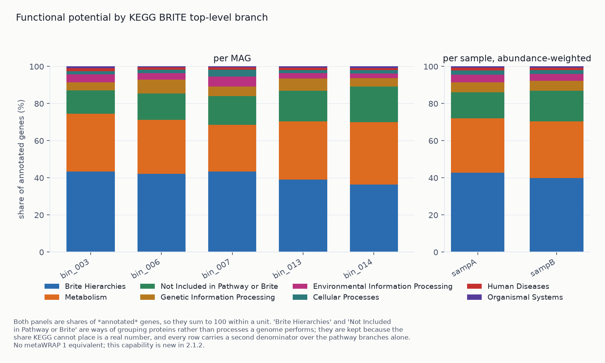
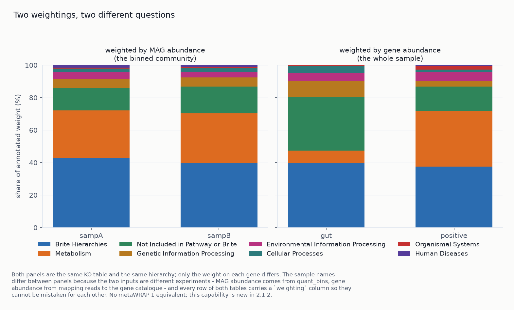
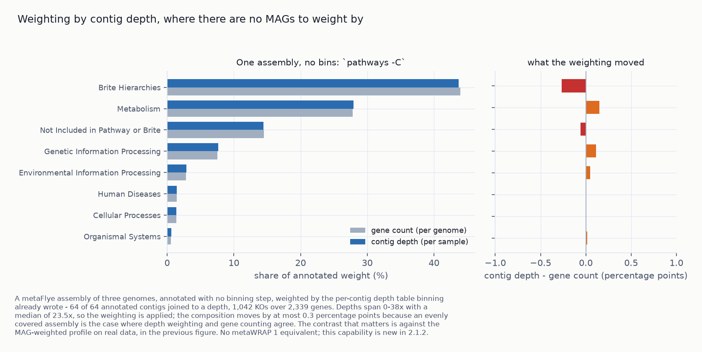
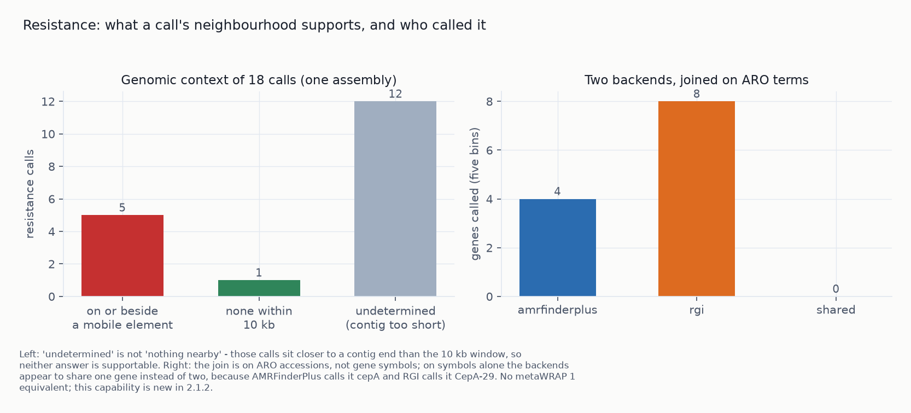
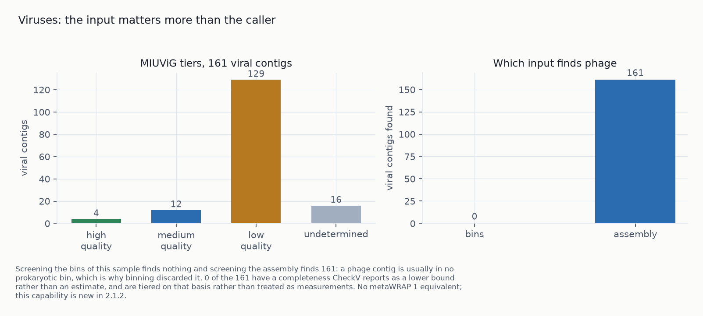
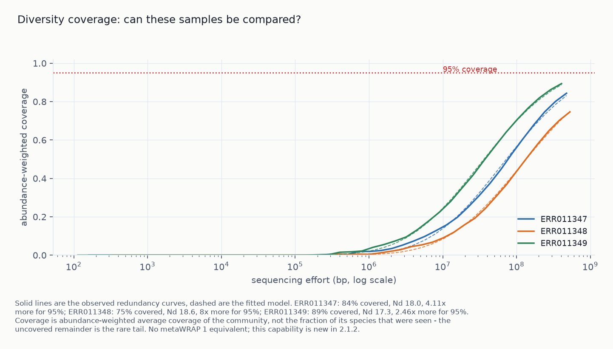
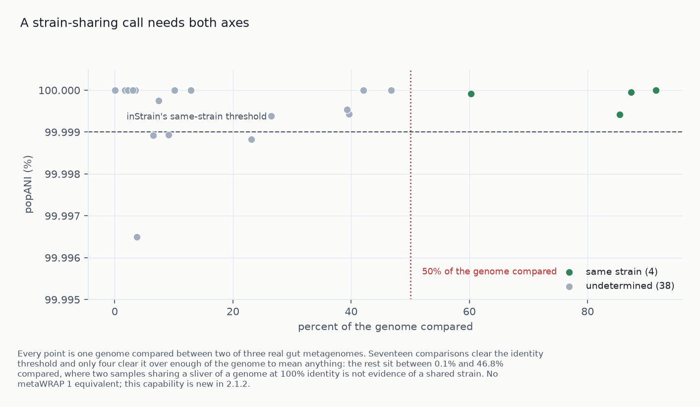
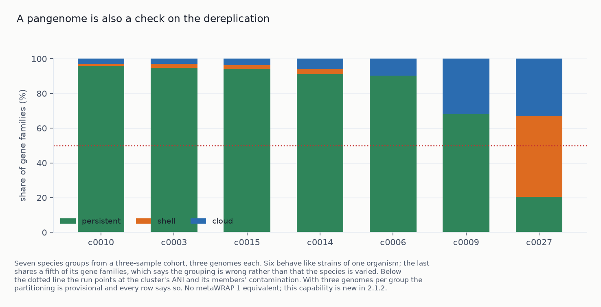
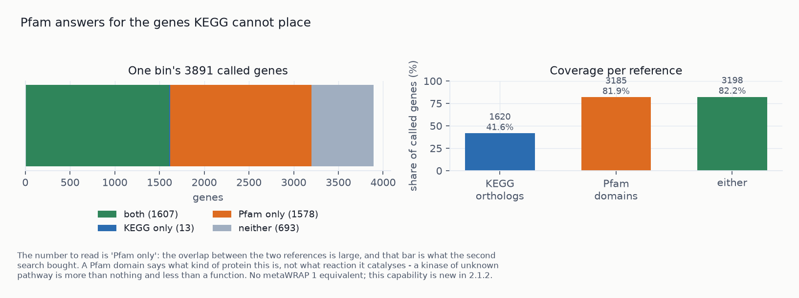

# 2.1.2 - what the genomes do, and what the sample holds besides them

Up to 2.1.1 the pipeline recovered MAGs; [Benchmarks](../benchmarks.md) covers that. This release
covers what comes after: what the genomes do, what else the sample contains, and how much of either
claim the data supports. Thirteen modules and flags are new or substantially extended. Every number
below was measured on this machine and can be reproduced from each run's `run_commands.txt`.

| | before | after |
|---|---|---|
| gene calling | one Prokka run per bin, GFF only | `annotate`: Pyrodigal over bins *or* a bare assembly, one joinable table |
| functional assignment | product names | `annotate --kofam`: KEGG orthologs, per-profile thresholds, score type per profile |
| pathways | none | `pathways`: KEGG module completeness computed here, both definitions, seven caveat flags |
| functional hierarchy | none | gene → chemical process → pathway as percentages, per genome and per sample (by MAG abundance, contig depth, or gene abundance), with Krona wheels |
| sample-level function | none | `quantify_function`: abundance-weighted, three units, BIOM output |
| bin-free path | none | `catalogue`: cross-sample gene catalogue, annotated once, now quantified by read mapping |
| resistance | none | `amr`: AMRFinderPlus, genomic context, evidence level, hAMRonization schema, ARO terms |
| ARG context | — | `--mobile-elements`: geNomad proviruses and plasmid contigs, so a call can reach L2 |
| viruses | discarded | `viruses`: geNomad + CheckV + vOTUs + CRISPR host links |
| diversity coverage | none | `nonpareil`: per-sample coverage, Nd, projected effort, cohort comparability verdict |
| what the bins miss | none | `recovery` (binned bp) and `appraise` (per-cell share, unrepresented lineages) |
| resistance backends | none | `amr --rgi`: RGI against CARD beside AMRFinderPlus, joined on ARO terms |
| strains | none | `strains`: popANI and TRACS transmission distances, both breadth-gated, reported side by side |
| long reads | none | `assembly -L` (metaFlye), `binning --long-read-type`, SemiBin2's long-read mode |
| protein domains | none | `annotate --pfam`: Pfam-A at each family's gathering threshold, +1,578 genes KEGG missed |
| pangenomes | none | `pangenome`: one per dereplication cluster, with its own sanity check on the clustering |
| phylogenies | none | `phylogeny`: IQ-TREE or FastTree over an alignment the pipeline already wrote |
| statistics | none | `diff_abundance`: ANCOM-BC, compositional by default |
| binning | one binner per preset tier | `--preset slow` runs three complementary binners; `--binsplit` for multi-split |

---

# Methods

**Data.** Functional and viral work: CAMI2 human microbiome challenge, gastrointestinal, short read.
One sample's assembly (19,233 contigs) and refined bins, plus five bins as the development set.
Read-level modules: three real human gut metagenomes (ERR011347-9, 10.4-12.0 M read pairs each),
since diversity coverage and per-cell fractions on a simulated community would measure the
simulation.

**Verification.** Every module was run on real data and its output read. Where a number could be
wrong without the output showing it, there is a control:

- `nonpareil` reimplements a published model and is checked against the original implementation.
- `viruses --crispr-hosts` returned zero host links, so the matcher is checked against sequence
  where it must find matches.
- `catalogue --quantify` is checked with reads cut from the catalogue itself (must map) and reads
  from an unrelated study (must not).
- `pathways` is checked against a published count of single-step KEGG modules.

**Cost.** Single-tool wrappers report wall time at a stated thread count. The CPU-hour harness
(`os.wait4`) is for comparisons that move a default; none of these additions is one. Cost is
reported beside quality and never divided into it.

**Caveats are in the output**, as a column or printed line: `permitted_language` per ARG row,
`effort_unit` per coverage row, chimerism and unbinned caveats beside bin counts, and a
`context_unknown` state distinct from "looked and found nothing".

---

# Results

## 1. Function: from gene names to pathway completeness

On one CAMI2 sample's refined bins, `annotate` calls 14,171 genes; 5,827 take a curated KEGG
ortholog (2,008 distinct KOs), at 76 s per bin on 48 threads.

`annotate` calls genes once, over a bin folder or a whole assembly, into one table every downstream
step reads. `annotate_bins` (Prokka per bin) is deprecated: it gave product names only, and could not
annotate an unbinned assembly, which holds most assembled sequence in any sample.

Three choices behind that number, where implementations differ:

- **Score type is per profile.** Of KOfam's 28,453 profiles, 17,890 calibrate their bit-score
  threshold on the full-sequence score and 8,697 on the best-domain score. Mixing them accepts hits
  KOfam would reject.
- **The 1,866 profiles with no threshold are dropped.** KEGG module M00851 "Carbapenem resistance"
  is a flat OR of 21 KOs, one thresholdless, so one permissive hit would report it complete. The
  strict default reproduces KofamScan, the arm with the highest eggNOG confirmation rate (84%) in
  Kananen et al. 2025.
- **A relative fallback is labelled.** An otherwise-unannotated gene can take its best hit at a
  stated fraction of the profile's threshold, marked `evidence=relative`. On one bin at 0.5× it adds
  355 calls to 949 curated ones.

### 1.1 Module completeness, and the parser bug the published counts hide

On the CAMI2 bins the two completeness definitions disagree on 9.7% of modules at ≥80% (158
against 144 of 2,865 module rows).

`pathways` computes KEGG module completeness itself and reports both definitions: `pathwise`
(best alternative route through the definition) and `stepwise` (fraction of top-level steps
satisfiable). Five published tools use five incompatible definitions; anvi'o reports 11-12% more
modules at ≥80% than MicrobeAnnotator or KofamScan on the same KOs.

A `+`-joined protein complex is one step whose subunits are all essential. M00142 (NADH
dehydrogenase, seven subunits) read as seven steps scores a genome with three of them 3/7 complete;
the biological answer is 0. Counting top-level spaces in the definition string reaches the right
total of 47 single-step modules through two cancelling errors: it treats a complex as a sequence
and a parenthesised group as one step.

Each module row carries seven flags for known ways completeness misleads, including: number of
top-level steps (47 modules have one, so completeness is binary); signature module or pathway;
whether a reaction has no KO (14 do, and can never reach 100%); and how many KOs are unique to it
(45 KOs appear in five or more modules).

### 1.2 Module completeness against MAG completeness — the loss is amplified

**A 70%-complete MAG, which passes the high-quality tier, has lost 59% of its complete modules.** One
genome was degraded by removing contigs, then re-annotated and re-scored at each step:

| genome completeness | complete modules (≥100% pathwise) |
|---|---|
| 100% | 58 |
| 95% | 52.7 |
| 90% | 48.0 |
| 80% | 37.0 |
| 70% | **24.0** |
| 50% | 15.0 |

The loss is roughly twice the sequence lost, because a module is complete only if every step is
present. Mean pathwise score falls 25% over the range while complete modules fall 74%, so the mean
hides the effect. `modules.tsv` carries the genome's CheckM2 completeness for this reason.

### 1.3 The hierarchy, and Krona wheels of it

**The gene-weighted profile puts 33% of its weight in "Not Included in Pathway or Brite", against
about 14%** for the MAG-weighted profiles, on a real run. Unbinned sequence is enriched in genes KEGG
cannot place, which a MAG-only report cannot show.

The hierarchy is gene → chemical process → pathway, from KEGG BRITE ko00001: 8 top-level branches,
57 chemical processes, 570 pathways, 28,545 genes. Per genome, genes are weighted equally (the
organism). Per sample, genomes are weighted by abundance (the community), so a rare genome
contributes little. Three sample weightings:

| flag | weights each gene by | the potential of | cost |
|---|---|---|---|
| `-a/--abundance` | its genome's abundance | the binned community | free, from `quant_bins` |
| `-C/--contig-depth` | its contig's depth | the whole assembly | free, from `binning`/`coverage` |
| `-G/--gene-abundance` | its own abundance | the whole assembly | one extra mapping pass |

Use `-a` when MAGs are the unit of analysis. Use `-C` when no bins are passed: the depth table from
`binning` and `coverage` covers every contig, including the ~90% of assembled sequence that never
reaches a MAG. `-G` measures each gene by read mapping, where contig depth assumes uniform coverage
along a contig; it needs the catalogue from `catalogue --quantify`. Any combination can be given;
each writes its own file, and every row carries a `weighting` column so tables cannot be
confused or summed.

Each weighting gets its own Krona wheels (`krona/sample_by_gene_abundance.<sample>.*.html`,
`krona/sample_by_contig_depth.<sample>.*.html`).

**The no-MAG route, end to end.** A metaFlye assembly of three genomes, annotated without binning
and weighted by the depth table `binning` wrote: 64 of 64 annotated contigs joined to a depth,
1,042 KOs over 2,339 genes, no second mapping pass. The composition lands within **0.3 percentage
points** of the gene-count profile, as expected for an evenly covered assembly (depths 0–38×, median
23.5×). The join can fail without an error, so the run reports how many annotated contigs got a
depth.

A KO can belong to several pathways (12,025 of 28,545 do; one belongs to 128), so each gene's weight
is split across its paths; counting once per path gives percentages above 100.

Two of BRITE's eight top branches are not biology. "Brite Hierarchies", the largest by a factor of
two, groups proteins and does not describe processes. Both branches stay in the table, since
dropping the unplaceable share inflates the rest, but they are flagged, every row carries both
denominators, and each unit gets a full and a pathway-only Krona wheel.

## 2. The bin-free path, now quantified

**`--quantify sample=r1,r2` maps reads to the catalogue with salmon** and writes gene abundance in
the long format `quantify_function` and `diff_abundance` read, so both paths reach the same tables.
Controls:

| sample | reads mapped | genes detected |
|---|---|---|
| reads cut from the catalogue's own genes | **100.00%** | 459 of 459 eligible |
| unrelated human gut reads (ERR011347) | **0.68%** | 429 |

Across 92,187 metagenomes in SPIRE, only about 10% of assembled base pairs reach a medium- or
high-quality MAG. `catalogue` covers the rest: it calls genes on all contigs, collapses them across
samples, and annotates the representatives once.

On the CAMI2 sample, 14,171 genes collapse to 14,074 representatives (0.7%), as expected for one
sample. Control: two identical inputs of 1,772 genes give 3,544 in, 1,753 out, **50.5% redundancy
removed**. Before gene ids were prefixed with their source, this control returned 1,772 genes and
1.1%: `mmseqs createdb` keys on the name, every assembler numbers contigs from one, so two samples'
genes merged before clustering, with no sign in the output.

Caveats:

- The mapping rate is written per sample, warned below 50%. Against a sample the catalogue was not
  built from, it measures overlap. It is read from salmon's own record; summing the abundance table
  double-counts multi-mapping reads and can exceed 100.
- salmon trims trailing runs of ten or more A's as poly-A tails. In a gene catalogue that is
  sequence, and length is the denominator of every salmon unit, so `--no-clip` is passed.
- In the positive control every gene got the same read count, yet TPMs differ 11.3-fold between a
  576 bp and a 3,411 bp gene: the difference between `--unit tpm` and `--unit reads`.

## 3. Resistance: detection, context, and a shared vocabulary

`amr` runs AMRFinderPlus on nucleotides, before any length filter. One published measurement
captures only 12% of ARG genomic contexts correctly, and MEGAHIT's ARG-bearing contigs average
284 bp, so a 300 bp filter applied first discards half the evidence.

Each row carries an evidence level from Cao et al. 2026's four-level ladder. The module reaches
**L1 and L2 only**; nothing it produces supports "confers resistance". Virulence factors go to a
separate table.

### 3.1 Genomic context, which is what L2 actually requires

**Five resistance calls sit on or beside a mobile element, and they are one finding.** On one CAMI2
assembly, `--mobile-elements` found 17 provirus regions with host-contig coordinates (10
carrying an integrase), 344 plasmid contigs and 239 viral contigs:

| | resistance calls | virulence calls |
|---|---|---|
| on or beside a mobile element | **5** | 2 |
| no element within 10 kb | 1 | 1 |
| undetermined (contig too short to support either answer) | 12 | 1 |

`ant(2'')-Ia`, `qacEdelta1` and `sul1` sit together on an 8.3 kb plasmid contig; `qacEdelta1` marks
a class-1 integron's 3' conserved segment. The fifth is `blaHBL` on another plasmid contig.

Without the flag every call is `context_unknown` at L1. `--mobile-elements DIR` reads a `metawrap2 viruses` output directory or a geNomad run
directory, and uses the geNomad database the viral
module already needs.

- A gene on a plasmid contig is reported at distance 0 with the element kind; a provirus gives a
  real distance.
- Whole-contig calls cannot support the negative. A gene on a contig not called a plasmid stays
  `context_unknown`: "no mobile element within 10 kb" requires a searched neighbourhood.

On the five dev bins, all four calls move from `context_unknown`/L1 to `no_mge_in_window`/L2,
supported by their 10.7-15.8 kb of flanking sequence.

### 3.2 Two tables that make a second backend worth having

**AMRFinderPlus and RGI share 2 genes, and neither is a superset.** On five CAMI2 bins, `--rgi` (RGI
against CARD, in its own environment because the solver requires one) makes 8 calls to
AMRFinderPlus's 4. RGI misses `ant(6)-Ia` and `sat4`, found by AMRFinderPlus at 100% identity;
AMRFinderPlus misses `adeF` and three vancomycin-cluster genes. Of RGI's 8, one is `Perfect` and
seven are `Strict` homologs at 27.8-46.1% identity; the tier is in the `method` column.

Agreement is joined on ARO accessions, not gene symbols. A symbol join found 1 shared gene where
2 were shared: `cepA` in AMRFinderPlus and `CepA-29` in RGI are the same beta-lactamase at 99.67%
identity.

`amr_hamronized.tsv` holds calls in hAMRonization's 36-field cross-tool schema, with tool and
database versions in each row. Versions are read from the binary inside the conda environment, not
`PATH`, the same fix this release made in `check`.

`amr_normalised.tsv` adds argNorm's ARO accession and the drugs each gene confers resistance to,
since one gene has a different symbol in every database. All four dev-set calls map, to 12 drugs
between them; one aminoglycoside phosphotransferase accounts for nine, so the summary groups by drug
with one line per gene. Unmapped calls stay in the table, counted separately: absence from the
ontology is not evidence a call is wrong.

## 4. Viruses

**Screening the bins finds zero viral contigs; screening the assembly finds 161.** A phage contig is
usually in no prokaryotic bin. Earlier versions binned prokaryotes and discarded phage.

`viruses` is the viral counterpart of `binning` plus `bin_refinement`: geNomad finds the contigs;
CheckV estimates completeness and trims host flanks off proviruses. On one CAMI2 sample:

| | count |
|---|---|
| viral contigs (≥2 kb, assembly) | 161 |
| high-quality (MIUViG) | 4 |
| medium-quality | 12 |
| low-quality | 129 |
| undetermined | 16 |
| proviruses trimmed of host sequence | 9 |
| completeness CheckV does not trust | 51 |
| plasmid contigs, same run | 344 |
| vOTUs at 95% ANI / 85% AF | 161 |

Tiers are CheckV's own MIUViG determination. Completeness CheckV reports as a lower bound is flagged:
51 of 161 are not reliable estimates, and reading them as measurements under-reports novel viruses.
The 161 → 161 vOTU result is not a no-op: skani returned zero qualifying pairs, and a duplicated
positive control collapses correctly.

### 4.1 CRISPR host prediction, and what it actually yields

**On the five dev bins, CRISPR spacers matched none of the sample's 161 viral contigs.** Three bins
carry arrays (one I-B, two I-C): 4 arrays, 54 spacers.

`--crispr-hosts BIN_FOLDER` runs CCTyper over the bins and matches spacers against the viral
contigs. A spacer records a past infection, so a match is direct evidence.

Control: every spacer is searched for in its source genome, where it must be found. All 54 are.
A link needs the host to carry a CRISPR system that recorded this virus, so no link is not evidence
of a missing host. Only arrays CCTyper trusts contribute spacers, since a spurious array matches the
host sequence it came from; `--untrusted-arrays` includes them.

## 5. Diversity coverage: can these samples be compared?

**The three real gut samples are covered to 74.6-89.4%**, under the kernel their read length calls
for:

| sample | reads | mean read length | coverage | Nd | more sequencing for 95% | model r |
|---|---|---|---|---|---|---|
| ERR011347 | 12.0 M | 39.5 bp | 84.4% | 17.97 | 4.1× | 0.9992 |
| ERR011348 | 10.4 M | 50.7 bp | 74.6% | 18.58 | 8.0× | 0.9995 |
| ERR011349 | 11.4 M | 35.7 bp | 89.4% | 17.27 | 2.5× | 0.9997 |

Cross-sample claims assume samples were seen to a similar extent, which depth in gigabases does not
establish. `nonpareil` estimates community coverage from reads alone, with no assembly or reference,
and is the cheapest step in the pipeline. It prints a cohort verdict: which samples fall below 50%
coverage, and whether the spread is wide enough to confound a diversity difference.

**The model fit is a Python port of Nonpareil's R package, verified against it.** On Nonpareil's
three bundled datasets it reproduces R's C, kappa, Nd, LRstar, model r and both gamma parameters to
six significant figures:

| dataset | C (R / port) | Nd (R / port) | LRstar (R / port) |
|---|---|---|---|
| HumanGut | 0.806352 / 0.806352 | 17.260378 / 17.260378 | 2.62214e9 / 2.62214e9 |
| IowaSoil | 0.557296 / 0.557296 | 22.795958 / 22.795958 | 6.62396e11 / 6.62396e11 |
| LakeLanier | 0.683087 / 0.683087 | 19.213483 / 19.213483 | 2.05296e10 / 2.05296e10 |

Three findings from building it:

- **The kernels disagree on short reads.** On ERR011347 the k-mer kernel reports 50.5% coverage and
  the alignment kernel 83.0%, projecting 47× against 4.4× more sequencing. At 34 bp against k=24 a
  read carries 11 k-mers. `--kernel auto` measures read lengths and picks one kernel **for the whole
  cohort**, so figures stay comparable. The k-mer kernel takes ~1.3 min per sample at 16 threads;
  the alignment kernel 12-16 min at 24 threads.
- **The k-mer kernel's effort axis is in k-mers.** Nonpareil's `AL` there is k-mers per read
  (17.129 against a read length of 40.129 at k=24). The first draft reported it as `total_bp`, a
  2.3× overstatement. Read length and effort length are now separate fields, each row carries
  `effort_unit`, and the projection divides like by like.
- **The alignment kernel seeds from the clock.** Two identical runs gave 83.0% and 84.3%. The seed
  is pinned with `-r 1337`, the binners' seed, and passed only to the kernel that accepts one.

The k-mer kernel refuses files containing reads shorter than k, which QC'd reads often contain:
406,546 of 12,036,979 in one real sample, 3.4%. These are filtered out and counted, since the effort
axis is then shorter than the library.

## 6. What the bins leave out

**The refined bins hold 58.7% of the assembly's base pairs but represent 11.6% of the bacterial
community.**

`recovery`, reported at the end of `bin_refinement`, measures binned sequence in base pairs (a bin
set can hold 2% of contigs and 60% of sequence). CAMI2 refined set: **17.8% of contigs, 58.7% of
base pairs.** The unbinned remainder is biased toward short contigs, low coverage and novel
lineages, and that caveat is printed with the figure.

`appraise` (new, against the SingleM GTDB r232 metapackage) compares markers in the reads with the
same markers in the genomes, weighted by coverage. The 26 refined bins of the ERR011347 study
represent 11.6% of that sample's bacterial community and 25% of its small archaeal one. **323
lineages have no genome at all**, led by *Phocaeicola*, *Bacteroides* and Lachnospiraceae; that list
is the more actionable output.

Two input mistakes give a confident wrong answer, so both are checked:

- Forward reads only: SingleM counts a read and its mate as two cells.
- Reads must not be trimmed below SingleM's 60 bp window. This sample's trimmed reads (mean 34 bp)
  gave 10 marker sequences from 12 million reads, appraising as the bins representing nothing; its
  raw 75 bp reads gave 1,431.

**Every quality tier carries a chimerism caveat** from GUNC. Of MAGs called high-quality, 54.5-81.8%
represent a single strain, with a mean of 2.3 reference genomes per MAG (Treichel et al. 2026). A
70/10 score means a bin has one genome's markers, not that it is one genome.

## 7. Statistics and interchange

`diff_abundance` uses ANCOM-BC, which scikit-bio ships natively, so no R is needed. Relative
abundances are compositional: one feature rising forces others down, and an ordinary t-test tests
that constraint. The design is `feature ~ group` only; covariates and repeated measures are left to
the user. The module refuses fewer than three labelled samples.

Every feature table can also be written as BIOM 2.1 (`--biom`). No other tool in the peer set
emits a standard object.

## 8. Binning: three binners in `--preset slow`, and multi-split

**End to end, the trio returns 64 high-quality / 60 clean MAGs for 120.68 CPU-hours and 2.36
GPU-hours**, against COMEBin alone at 61/57 for 80.87 and 1.73. `--preset slow` now runs
**metaBAT2 + SemiBin2 + COMEBin** instead of COMEBin alone, chosen on measured complementarity.
Clean high-quality MAGs on the gold assembly, and how many each binner alone finds:

| binner | clean HQ MAGs | unique to it |
|---|---|---|
| COMEBin | 176 | 39 |
| SemiBin2 | 116 | 4 |
| VAMB | 80 | 0 |
| metaBAT2 | 35 | 0 |
| MaxBin2 | 33 | 1 |
| CONCOCT | 28 | 0 |

The best pair reaches 181; the best trio, COMEBin + SemiBin2 + MaxBin2, reaches 182, one more
than the shipped trio's 181. metaBAT2 is chosen on cost and cleanliness: MaxBin2's extra genome
costs 24.5 CPU-hours against metaBAT2's ~1.5, and only 37.7% of MaxBin2's bins pass GUNC.

Caveat: on the gold assembly the trio and COMEBin alone tie (177 against 176). Ensembles help more on
real per-sample assemblies, so gold-only binner comparisons understate them.

### 8.1 Multi-split binning: measured, and it does not beat the shipped cohort path

**Splitting a catalogue's bins helps; binning a catalogue does not beat per-sample binning.**

`binning --binsplit SEP` bins the concatenated catalogue so the model sees every sample's
composition, then splits clusters back per sample. SemiBin2 and VAMB do this natively; metaBAT2,
MaxBin2 and CONCOCT are split afterwards. Same three-sample catalogue, differing only in splitting:

| bin set | bins | near-complete | high-quality | clean HQ | GUNC pass | GUNC could not assess |
|---|---|---|---|---|---|---|
| metaBAT2, unsplit | 86 | 13 | 21 | **16** | 60.5% | 0% |
| metaBAT2, split | 166 | 23 | 42 | **37** | 55.4% | 10.8% |
| MaxBin2, unsplit | 114 | 10 | 25 | **15** | 60.5% | 0% |
| MaxBin2, split | 258 | 13 | 30 | **19** | 60.1% | 9.3% |

Cost is 3.29 against 3.28 cpu-hours, since splitting is a pass over written bins. Clean HQ joins
the CheckM2 and GUNC reports per bin; it is never an HQ count multiplied by a pass fraction.

Against the shipped cohort path (same assemblies and cross-sample depth table, binning per sample),
with identical refinement and dereplication:

| arm | genomes | near-complete | high-quality | clean HQ | GUNC pass | cpu-h (bin+refine+derep) |
|---|---|---|---|---|---|---|
| per-sample binning *(shipped)* | 46 | **23** | 37 | **34** | **87.0%** | **8.71** |
| multi-split | **47** | 22 | **38** | 29 | 70.2% | 9.09 |

Multi-split gives more bins, fewer clean genomes and slightly more compute. One cluster over a
concatenated catalogue can gather near-identical contigs from different samples, and splitting
separates them without unmixing them, as the GUNC column shows.

Söding's reported +19% bins and +79% high-quality bins do not reproduce here, likely because
per-sample binning on a cross-sample depth table already has the cross-sample information. The
published comparison is against single-sample coverage, this benchmark's arm b, which also returns
29 clean MAGs.

`--binsplit` stays a flag, needed by anyone binning a catalogue, including SemiBin2's and VAMB's
multi-sample modes. Caveat: one dataset, three samples, two classical binners. The next experiment
is the learned binners, since the paper's claim is about the embedding, not the clustering.

## 8.2 Strains: is this the same strain in two samples?

**Of 17 comparisons at popANI ≥ 99.999%, 4 cover enough of the genome to count.** Three real gut
metagenomes (ERR011347-9) against this repo's 26 refined bins, 42 comparisons:

| | count |
|---|---|
| comparisons with popANI ≥ 99.999% | 17 |
| **of those, over enough of the genome to mean it** | **4** |
| the rest, at 0.1-46.8% of the genome compared | 13 |

bin.1, bin.2, bin.4 and bin.18 are shared between ERR011347 and ERR011348 at 60-92% of the genome
compared, with 0-2 population SNVs. **Without the breadth floor the module would report 17 shared
strains instead of 4**: two samples sharing 2% of a genome at 100% identity give popANI 100%.

`strains` maps every sample against one genome set, runs inStrain per alignment, and compares every
sample pair for every shared genome. A MAG is a population consensus, so 99.9%-identical MAGs can
carry different strains.

Diversity is gated on `breadth_minCov`, not bare breadth. One real genome is 91% covered, with a
quarter of that deep enough to call variants.

**Two backends, reported side by side and never averaged.** `--backend tracs` runs TRACS, which
estimates a transmission distance from a consensus SNP distance, accounting for within-host
diversity and a clock. Each backend keeps its own published threshold. On real data they agree: of
three genomes inStrain called shared, TRACS compared two and called both shared (bin.1 at 5 raw SNPs
and 0 after filtering over 2,006,904 sites, bin.4 at 2 → 0 over 190,068) and skipped the third for
coverage. TRACS's own 25% breadth floor means a shallow sample yields no row.

## 8.3 Pangenomes, and what they say about the clustering

**Six of seven species groups look like strains of one organism; the seventh points to a
dereplication problem.** On the three-sample cohort, 46 clusters gave 7 groups and 32 singletons.
The groups, three genomes each:

| group | gene families | persistent | shell | cloud |
|---|---|---|---|---|
| cluster_0010 | 2,582 | 96% | 1% | 3% |
| cluster_0003 | 3,923 | 95% | 2% | 3% |
| cluster_0015 | 4,099 | 94% | 2% | 4% |
| cluster_0014 | 4,187 | 91% | 3% | 6% |
| cluster_0006 | 4,822 | 90% | 0% | 10% |
| cluster_0009 | 3,779 | 68% | 0% | 32% |
| **cluster_0027** | **7,361** | **21%** | **46%** | **33%** |

cluster_0027's 7,361 families over a mean of 3,214 genes per genome mean its three "genomes" barely
share gene content. The run flags any group below 50% persistent and suggests checking the cluster's
ANI and members' contamination.

`pangenome` builds one pangenome per dereplication cluster, since a pangenome is defined over a
species. Most cohorts yield few, and the run reports group and singleton counts.

Caveat: with three genomes per group the persistent/shell/cloud split is provisional, and every row
says so. PPanGGOLiN's own guidance is at least 15.

## 8.4 Phylogenies from alignments that already exist

`phylogeny` uses an alignment the pipeline already has: GTDB-Tk's 120-marker concatenation (species
placement) or `pangenome --msa`'s core-gene alignment (strains within a species). It records which
it was given, since universal markers cannot resolve strains.

The default is IQ-TREE with ModelFinder and ultrafast bootstrap; `--fast` uses FastTree for hundreds
of genomes. Each tree reports the alignment's occupancy beside its support, because bootstrap cannot
see markers missing from an incomplete MAG, horizontal transfer, or contamination.

## 8.5 Long reads

**Simulated nanopore reads assemble to 72 contigs, 2.41 Mbp, N50 57.9 kb, then four bins.** Input:
25× R10 nanopore reads (badread, nanopore2023 model) over three CAMI2 MAGs totalling 2.50 Mbp. The
read scanner's N50 of 12,326 bp matches Flye's log to the base pair.

`assembly -L reads.fastq --read-type {ont,ont-hq,pacbio,pacbio-hifi}` assembles with metaFlye;
`binning --long-read-type ont-hq` maps the reads back with the matching minimap2 preset. The
platform has three tool-specific names (Flye's `--nano-hq`, minimap2's `-x map-ont`, SemiBin2's
`--sequencing-type=long_read`) and is set in one place.

The run checks the declared platform against the reads, catching a short-read FASTQ path (metaFlye
assembles it badly instead of refusing) and HiFi declared over nanopore-accuracy data. Not done,
and stated in the output:

- No short-read polishing: reads from a close relative rewrite one strain's consensus into
  another's.
- No merging of long- and short-read assemblies: a merged metagenome assembly cannot tell a
  duplicate contig from a novel one.

## 8.6 Protein domains, for the genes KEGG cannot place

**Pfam annotates 1,578 genes that KEGG leaves blank, 40.6% of called genes on a real CAMI2 bin.**

| | genes | share |
|---|---|---|
| called | 3,891 | |
| with a KEGG ortholog | 1,620 | 41.6% |
| with a Pfam domain | 3,185 | 81.9% |
| **with a Pfam domain and no KO** | **1,578** | **40.6%** |

`annotate --pfam` searches Pfam-A with PyHMMER at each family's own gathering threshold, as
KOfam uses per-profile cutoffs: one e-value across 21,000 families suits long conserved families and
not short ones.

The run reports the increment, not the 81.9%. Only 13 genes have a KO and no Pfam domain. Output
is per domain, since 54.7% of annotated genes carry more than one; `pfam_architectures.tsv` gives
the ordered list ("ABC transporter + periplasmic binding" differs from either domain alone).

InterProScan is not wrapped: a Java wrapper around a dozen member databases, a bioconda build four
years old, about 50 GB of data. Pfam is 399 MB. TIGRFAM, PANTHER, SMART, GO terms and transmembrane
topology are listed as a gap.

## 9. Correctness fixes with numbers attached

**Three environment pins allowed a known-broken version.**

- GUNC ≤1.0.6's `summarise` flagged every genome as passing, and the recipe's floor was that
  version, so any arm scored with it had meaningless chimerism numbers.
- CheckM2 ≤1.0.2 gives batch-dependent scores; 1.1.0 also fixes a TensorFlow import failure.
- GTDB-Tk is now pinned to a range instead of `>=2.4.0`, which resolves to a version needing ~140 GB
  of RAM.

**CoverM counted every alignment however poorly it matched.** `--min-read-percent-identity` and
`--min-read-aligned-percent` default to 0 in CoverM, so reads cross-mapping from relatives inflated
MAG abundance (the depth table already had a 90% identity floor in `depth.py`). Both floors are now
set explicitly and recorded in provenance.

**One install bug, four registries.** Four tables mapped names onto conda environments, each keyed
differently, each read by a different subset of consumers. Three rounds of call-site fixes and two
user-reported failures traced back to it. `config.resolve_env_name` now reads all four in a stated
precedence and every command uses it: **38 names resolve across 11 environments, where 25 resolved
before and four that the runtime itself uses did not.** Four invariants are asserted.

**Two packaging defects in cctyper.**

- bioconda's 1.9.0 activation script exports `CCTYPER_DB=$CONDA_PREFIX/cct_data`, a 1.8-era
  directory without the profile database 1.9 needs, so a fresh install exits with "Could not find
  HMM profile database". MetaWrap2 passes `--db`, resolved by importing cctyper inside the
  environment.
- cctyper pulled in a pandas 3.0 build compiled against numpy 2, beside the numpy 1.26 geNomad's
  numba requires; conda installs this without complaint and cctyper dies on `import pandas`.
  `envs/viruses.yaml` pins `pandas <3`.

**A unit was inferred.** `parse_singlem_fraction` assumed values above 1 were percentages, so a
host-dominated sample at 0.8% read as 80%: a 100× error in the denominator of every abundance.
SingleM's `read_fraction.py` computes `* 100` capped at 100, so the parser now divides
unconditionally and raises above 100.

**A help string was formatted twice.** A literal `19%` left for argparse to interpolate made every
`--help` in the package fail with "unsupported format character". A test that renders every shipped
command's help caught it.

**KOfam ran on one core with KOfam's shipped layout.** `hmmsearch` parallelises across queries, and
the search called it once per profile file. With one `.hmm` per KO (27,930 files) that is 27,930
single-query searches, leaving `--threads` nothing to divide. On 2,339 genes the step held **108%
CPU and had not finished in ten minutes; batched into one search it takes 80 seconds** above
1000% CPU. The concatenated `profiles.hmm` layout, used by every earlier run, was unaffected.
Profiles are opened one file at a time and streamed, since 27,930 open handles would exhaust the
descriptor limit.

### Found while preparing the release

- `install-env --from-lock` never used the lockfiles. The option was parsed and ignored, so every
  "reproducible" install solved the yaml. It now installs the committed lockfile, and says when an
  environment has none for the platform. Lockfiles are named after the environment
  (`bins.linux-64.lock`), whatever name `--lock` was given.
- `--dry-run install-env` built the environments it was asked to print.
- pyrodigal and pyhmmer were imported but not declared as dependencies, so `annotate` failed after a
  plain `pip install`. A test now checks that every module-level import is declared.
- Python 3.14 is tested in CI.
- The KOfam thresholds (`ko_list`) and the BRITE hierarchy are downloaded at install time:
  `metawrap2 install-db kofam` fetches the profiles and their thresholds together, and
  `metawrap2 install-db kegg` fetches BRITE `ko00001` and writes the table `pathways` reads
  (`KEGG_BRITE`). Every row records which threshold list and which hierarchy download it used, and
  `annotate` warns if the thresholds differ from the list this release was validated on. Without
  `KEGG_BRITE`, `pathways` still writes module completeness and skips the hierarchy.
- Eight environments added in this release (amr, viruses, strains, comparative, singlem, rgi, tracs
  and benchmark-amber) have no lockfile yet. `--from-lock` solves those from the yaml until the
  monthly Lockfiles workflow writes them.

## 10. Limitations

**One simulated dataset for the functional work, three real samples for the read-level work.** The
module-completeness degradation curve covers two genomes. Its shape is steep enough that a third is
unlikely to change the conclusion, but the numbers in §1.2 are a small sample.

**Zero is a common answer and needs careful reading.** The CRISPR host link found nothing on this
sample, and 12 of 18 ARG mobility calls are undetermined. Both are valid single-sample results, not
method failures, and the output says so. Neither has been demonstrated on a dataset where the
positive case is common.

**`appraise` is new, and its per-cell figure depends on untrimmed reads.** 11.6% is a real number
for that bin set; the 10-versus-1,431 marker-sequence result shows how easily it becomes a
confident zero.

**Open items, each with its blocker:**

- PlasMAAG needs the assembly graph, which `assembly` currently deletes. The first change is a
  retention flag with a measured disk cost, not a new module.
- InterProScan's remaining member databases (TIGRFAM, PANTHER, SMART, the signal-peptide and
  transmembrane predictors) are a real gap. Pfam covers domains; GO terms and topology are not
  produced.
- VFDB waits on a measured arm. It ships no per-gene thresholds, and `amr` cannot license a call
  whose threshold this project chose.
- MIMAG rRNA/tRNA tagging is halted on instruction.

**State.** The test suite passes on Python 3.10 to 3.14, and ruff, black, isort and mypy are clean.
`--preset slow`'s trio, the KEGG module definitions, the KOfam thresholds and the BRITE hierarchy are dated and recorded in
provenance.
