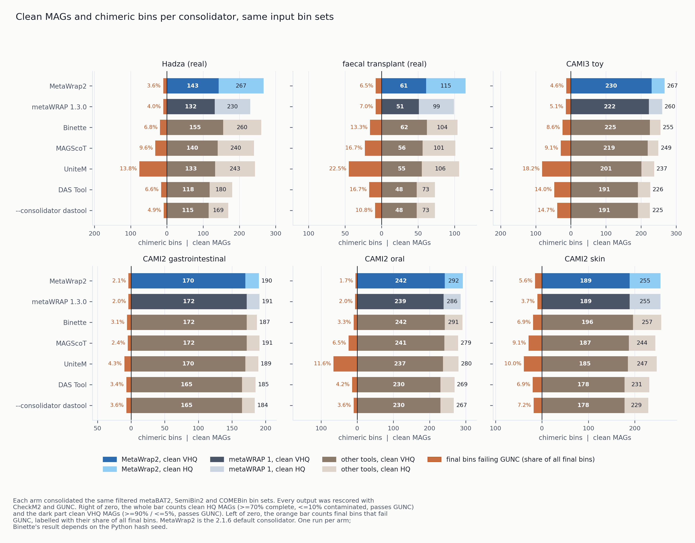

# 2.1.6 - Slurm executor, new default bin consolidation, consolidator benchmark

The Slurm executor contributed by Matthew Nguyen was merged after the 2.1.5 tag, so it ships in
this release. `bin_refinement` has a new default consolidator that also builds unions and
differences of overlapping bins; the metaWRAP 1 method is kept as `--mw1-refinement`. The release
also reuses bin scores across runs, adds a benchmark of
`bin_refinement` against metaWRAP 1.3.0 and four other consolidators on six datasets, and corrects
several benchmark descriptions in the documentation.

## New

- **Slurm executor**, contributed by Matthew Nguyen (pull request #8). `run` and `cohort` with
  `--executor slurm` submit each step as one Slurm job and wait for every job of a stage before
  starting the next. Job options are set under `[slurm]` and `[slurm.modules.<module>]` in
  `metawrap2.toml` or with `--slurm-partition`, `--slurm-account` and the other `--slurm-*` flags;
  `-t` and `-m` set each job's CPUs and memory, and `-j` how many jobs of a stage are queued at
  once. Job IDs are kept in the manifest, so `--resume` reconnects to jobs that outlived the driver
  instead of submitting them again; Ctrl-C cancels the running jobs. The cost of each job comes
  from `sacct`. A binning step on `--device cuda` requests one GPU. See
  [Running on Slurm](../docs/usage.md#running-on-slurm).
- **Tests for global flags in studies**, contributed by Matthew Nguyen (pull request #7). They
  check that each budget flag and a zero `--heartbeat-seconds` reach the steps of both `run` and
  `cohort`, and that the flags come before the module name in each step's command. The fix they
  test shipped in 2.1.5.

- **Scores are reused across runs.** A bin already scored with the same scorer, tool version and
  database is not scored again by a later `bin_refinement`, `score`, `reassemble_bins` or
  `binning --run-checkm` run. Bins are matched by their sequences, not their contig names. Another
  consolidator benchmark reran an identical candidate pool in 9 s instead of 1,934 s. Scores are
  kept in `~/.metawrap2/score_cache`; `[settings] score_cache_dir` moves it (an empty value turns
  it off) and `--no-score-cache` turns it off for one run. If the scorer's version or database
  cannot be identified, the run keeps its scores to itself and says so. `run_config.json` records
  how many scores were reused.

- **`bin_refinement -b/--bin-sets DIR1,DIR2,...`** gives the bin sets as one comma-separated list,
  or with `-b` repeated once per folder. The default consolidator and `--consolidator dastool` take
  any number of sets; `--mw1-refinement` takes 2 to 6. A single set is not consolidated, and
  `-c`/`-x` are applied to it. `-A` to `-F` still work but are no longer documented, and cannot be
  mixed with `-b`.

### New default bin consolidation

`bin_refinement` has a new default consolidator, `--consolidator metawrap2`. It adds two kinds of
candidate bin to the Binning_refiner intersections. Two input bins are linked when they share
contigs. For each group of input bins that are all linked to each other (a clique of this overlap
graph) it builds their union and the difference of each bin and the others. A group whose bins do
not all overlap gets no union, so a chain A-B-C where A and C share nothing does not give A∪C.

Every candidate is scored with CheckM2 (CheckM1 with `--checkm1`), and bins are picked from the
highest score down, with no contig in two bins. A union or difference is kept only if its score
exceeds that of the greedy packing of the original bins and intersections it would block; otherwise
those are kept. After selection the plots, final layout and GUNC are the same as before.

How it differs from the metaWRAP 1 method, the default up to 2.1.5 and now `--mw1-refinement`:

- The metaWRAP 1 method never merges bins. Binning_refiner intersects the input sets, so every
  candidate is an input bin or the part of one that two or three binners agree on. The
  consolidation step then compares the bin sets two at a time and, for each bin, keeps whichever
  version scores best among the bins that share at least 80% of its length. It chooses between
  versions of one bin, and no output bin can be more complete than the most complete input bin.
- The new method adds unions. When two binners each hold part of one genome, their union can be
  more complete than either part, and it is kept if it scores higher.
- It adds differences: what is left of a bin after removing the contigs another binner put
  elsewhere, which can remove a contaminating fragment.
- It ranks every candidate from every set in one list and takes the best first, instead of
  matching bins pairwise by 80% overlap. The check against the blocked packing stops one union
  from taking the contigs two separate good bins needed.

With unions and differences turned off, the new method gave 258 clean HQ MAGs on Hadza; with them,
267. On the faecal-transplant series they added four (111 to 115), and on the four CAMI datasets
zero to three.

The clique candidates and the pruning of the candidate pool follow Binette (Mainguy and Hoede,
*JOSS* 2024), and unions of bins as candidates follow MAGScoT (Rühlemann et al., *Bioinformatics*
2022). The check against the packing a derived bin would block is not in either tool.

Measured on the same three bin sets per dataset against metaWRAP 1.3.0, Binette, MAGScoT, UniteM
and DAS Tool (see the tables below):

- Most clean HQ MAGs on four of six datasets: Hadza (267 against 260 for Binette), the
  faecal-transplant series (115 against 106 for UniteM), CAMI2 oral (292 against 291) and CAMI3 toy
  (267 against 260 for metaWRAP 1.3.0). Second on CAMI2 skin (255 against 257 for Binette) and
  third on gastrointestinal (190 against 191). Mean rank over the six datasets 1.50, against 2.67
  for Binette and 3.00 for metaWRAP 1.3.0.
- Run at `-c 90 -x 5`, the most clean VHQ MAGs on the faecal-transplant series (63 against 62),
  CAMI3 toy (233 against 226) and CAMI2 oral (247 against 242), tied with Binette on CAMI2
  gastrointestinal (173), and second to Binette on Hadza (153 against 155) and CAMI2 skin (193
  against 196).
- In the 70/10 runs, a lower share of final bins failing GUNC than Binette, MAGScoT, UniteM and DAS
  Tool on every dataset. At 90/5 MAGScoT is cleaner on CAMI2 gastrointestinal and skin.
- Fewer CPU-hours than metaWRAP 1.3.0 on CAMI2 (26.7, 46.6 and 51.7 against 48.6, 69.9 and 72.9)
  but 12-17x Binette's (2.2-3.1). CheckM2 predicts genes and runs DIAMOND on each candidate bin
  separately. Binette predicts genes and runs DIAMOND once per assembly and sums per-contig
  features for each candidate, about 17 times faster per candidate in a wall-time comparison.
  CPU-hours on the other datasets were not measured cleanly.

Other options:

- `--contamination-weight W` (default 5) sets W in the selection score completeness − W ×
  contamination of the default consolidator. It does not apply to `--mw1-refinement` or
  `--consolidator dastool`.
- `-c`/`-x` are the target the default consolidator selects for, not a filter applied to its
  output. For near-complete genomes, run with `-c 90 -x 5` instead of filtering a 70/10 run: this
  gave 153 clean VHQ MAGs against 143 on Hadza, 63 against 61 on the faecal-transplant series and
  247 against 242 on CAMI2 oral. With `--consolidator dastool`, DAS Tool does not receive them; they
  filter the consolidated set after it is re-scored.
- `--mw1-refinement` runs the metaWRAP 1 method, the 2.1.5 default. With `--checkm1` it returns the
  same bins as metaWRAP 1.3.0's `bin_refinement`. `--skip-checkm`, `--skip-refinement`,
  `--skip-consolidation`, `--refine-combinations`, `--keep-ambiguous` and `--remove-ambiguous`
  belong to that method; given without a consolidator, they run it.
- The default consolidator needs neither `-a/--assembly` nor an extra environment: union bins are
  written from the contigs in the input bin files.
- Scripts that pass `--consolidator metawrap` (the 2.1.5 default) still get the metaWRAP 1 method,
  and `--consolidator hybrid`, the name used during development, is the new default.

```bash
metawrap2 bin_refinement -o BIN_REFINEMENT -t 32 -c 70 -x 10 \
    -b INITIAL_BINNING/metabat2_bins,INITIAL_BINNING/semibin2_bins,INITIAL_BINNING/comebin_bins
```

End-to-end runtimes and MAG counts in the other benchmark sections were measured with the 2.1.5
default, the metaWRAP 1 method, except `--preset deep` on the Hadza sample and the
faecal-transplant series ([Real samples](../docs/benchmarks.md#25-real-samples)). Those two cells
now use the new default from the consolidator benchmark: 267 clean MAGs in 11.1 h and 115 in 4.8 h,
against 250 in 9.5 h and 111 in 4.7 h before. The added wall time is estimated from runs that
reused some scores.

## Fixed

- **Tool steps failed when mamba or conda was not on PATH.** Non-login shells and batch jobs often
  have neither on PATH. When mamba is not on PATH, MetaWrap2 now looks in `[settings]
  env_manager` (a path to mamba or conda), `$MAMBA_EXE`, `$CONDA_EXE`, then `bin/` and `condabin/`
  under `~/miniforge3`, `~/mambaforge`, `~/miniconda3`, `~/anaconda3` and `~/micromamba`. If none
  is found, the error lists where it looked and what to set.
- **Errors went only to the log.** A module that stops on an error now also prints
  `metawrap2 <module>: error: <first line of the message>` to stderr, for example when `score` is
  pointed at an existing output directory.
- **The disk ceiling stopped runs on large filesystems with plenty of space left.**
  `[limits] max_disk_fraction` (default 70%) is a share of the whole filesystem, so on a large
  filesystem a run could stop with terabytes free. A filesystem over the fraction now counts as full only when it also has less
  than `[limits] min_free_disk_gb` free (default 200 GB; the global `--min-free-disk-gb N` for one
  run). 0 makes
  the fraction alone decide, as before.
- **A run that stopped early left output that looked finished.** A run stopped by the disk ceiling,
  an error or a signal could leave, for example, a partial set of `bin_refinement` bin folders,
  which a script globbing `metawrap_*_bins` reads as a run that recovered nothing. Each module now
  writes `RUN_INCOMPLETE` in its output folder when it starts and removes it when it finishes. If the
  run stops early the file says which step stopped, the last finished step and why, and how to
  continue with `--resume`. The exit code is 1 after an error and 130 (or 128 plus the signal
  number) after an interrupt.
- **`score` could give two genomes one score.** Within a run, bins were matched by contig names
  only, so genomes from different sources with the same names (for example single-contig files
  whose contig is called `>1`) shared a cached score. Each contig's sequence is now part of the
  match.
- **The contamination weight was defined twice**, in `constants.py` and in
  `scripts/choose_best_bin.py`. The script now uses the shared constant; its output is unchanged.
- **`score` into an existing output directory** now says how to continue (`--resume` reuses the
  scores already in the directory), replace (`--force`) or keep (a new `-o`) the earlier run.

## Consolidator benchmark

Seven consolidation arms were given the same input on six datasets: the metaBAT2, SemiBin2 and
COMEBin bin sets of `--preset deep`, each filtered to bins of 200 kb to 20 Mb, and the same
assembly. The datasets are the pooled gold assemblies of CAMI2 gastrointestinal, oral and skin and
of the CAMI3 toy dataset, one deeply sequenced Hadza gut sample (ERR7745335) and a three-sample
faecal-transplant series (PRJNA701961, one co-assembly). Every output was rescored with CheckM2,
GUNC and the MIMAG tags. A clean HQ MAG is ≥70% complete and ≤10% contaminated by CheckM2 and
passes GUNC; a clean VHQ MAG is ≥90% complete and ≤5% contaminated and passes GUNC. The tables are
in [Benchmarks](../docs/benchmarks.md#consolidators). MetaWrap2 below is the 2.1.6 default.



| clean HQ MAGs (CPU-hours) | CAMI2 gastrointestinal | CAMI2 oral | CAMI2 skin | CAMI3 toy | Hadza | faecal transplant |
|---|---:|---:|---:|---:|---:|---:|
| MetaWrap2 | 190 (26.7) | 292 (46.6) | 255 (51.7) | 267 | 267 | 115 |
| metaWRAP 1.3.0 | 191 (48.6) | 286 (69.9) | 255 (72.9) | 260 (82.3) | 230 (21.8) | 99 (18.5) |
| Binette 1.2.1 | 187 (2.2) | 291 (3.0) | 257 (3.1) | 255 (4.5) | 260 (2.8) | 104 (1.4) |
| MAGScoT | 191 (1.5) | 279 (2.3) | 244 (2.2) | 249 (5.3) | 240 (2.2) | 101 (0.9) |
| UniteM 1.2.6 | 189 (4.7) | 280 (6.7) | 247 (6.9) | 237 (10.9) | 243 (5.8) | 106 (2.6) |
| DAS Tool 1.1.7 | 185 (1.4) | 269 (2.5) | 231 (2.4) | 226 (6.0) | 180 (2.3) | 73 (0.9) |
| `--consolidator dastool` | 184 (8.0) | 267 (12.7) | 229 (12.2) | 225 (15.5) | 169 (6.1) | 73 (2.7) |

MetaWrap2's CPU-hours are given only where it scored its whole candidate pool. On the other
datasets it reused scores from development arms run before it on the same bin sets, so its
CPU-hours were not measured cleanly.

Mean rank by clean HQ MAGs over the six datasets (1 is best; tied arms share the better rank):

| arm | mean rank | ranks per dataset |
|---|---:|---|
| MetaWrap2 | 1.50 | 3, 1, 2, 1, 1, 1 |
| Binette | 2.67 | 5, 2, 1, 3, 2, 3 |
| metaWRAP 1.3.0 | 3.00 | 1, 3, 2, 2, 5, 5 |
| UniteM | 3.67 | 4, 4, 4, 5, 3, 2 |
| MAGScoT | 3.83 | 1, 5, 5, 4, 4, 4 |
| DAS Tool | 6.00 | 6, 6, 6, 6, 6, 6 |
| `--consolidator dastool` | 6.83 | 7, 7, 7, 7, 7, 6 |

Ranks per dataset are in the column order of the table above (CAMI2 gastrointestinal, oral, skin,
CAMI3 toy, Hadza, faecal transplant). Head to head, MetaWrap2 won-lost-tied 4-1-1 against
metaWRAP 1.3.0, 5-1-0 against Binette and MAGScoT, and 6-0-0 against UniteM, DAS Tool and
`--consolidator dastool`.

Share of final bins that fail GUNC, 70/10 runs:

| | CAMI2 gastrointestinal | CAMI2 oral | CAMI2 skin | CAMI3 toy | Hadza | faecal transplant |
|---|---:|---:|---:|---:|---:|---:|
| MetaWrap2 | 2.1% | 1.7% | 5.6% | 4.6% | 3.6% | 6.5% |
| metaWRAP 1.3.0 | 2.0% | 2.0% | 3.7% | 5.1% | 4.0% | 7.0% |
| Binette | 3.1% | 3.3% | 6.9% | 8.6% | 6.8% | 13.3% |
| MAGScoT | 2.4% | 6.5% | 9.1% | 9.1% | 9.6% | 16.7% |
| UniteM | 4.3% | 11.6% | 10.0% | 18.2% | 13.8% | 22.5% |
| DAS Tool | 3.4% | 4.2% | 6.9% | 14.0% | 6.6% | 16.7% |
| `--consolidator dastool` | 3.6% | 3.6% | 7.2% | 14.7% | 4.9% | 10.8% |

Clean VHQ MAGs from runs at the near-complete target. Each tool was also run at 90/5 in its own
units (MAGScoT also at 70/10), and each cell is the better of its runs; the MetaWrap2 row is its
90/5 run. The full table, with the run used for each cell, is in
[Benchmarks](../docs/benchmarks.md#consolidators).

| clean VHQ MAGs | CAMI2 gastrointestinal | CAMI2 oral | CAMI2 skin | CAMI3 toy | Hadza | faecal transplant |
|---|---:|---:|---:|---:|---:|---:|
| MetaWrap2, 90/5 | 173 | 247 | 193 | 233 | 153 | 63 |
| metaWRAP 1.3.0 [b] | 172 | 239 | 189 | 222 | 132 | 51 |
| Binette | 173 | 242 | 196 [b] | 226 | 155 [b] | 62 [b] |
| MAGScoT [b] | 172 | 241 | 190 | 220 | 140 | 56 |
| UniteM | 170 | 237 | 185 | 201 | 133 | 55 [b] |
| DAS Tool [a] | 165 | 230 | 178 | 191 | 118 | 48 |
| `--consolidator dastool` [b] | 165 | 230 | 178 | 191 | 115 | 48 |

[a] DAS Tool has no completeness or contamination threshold, so it has one run. [b] A run at a
looser target (70/10, or MAGScoT's own defaults) recovered more than the run at 90/5. For MAGScoT
and UniteM the thresholds filter the selected bins instead of steering the selection, so a stricter
threshold removes genomes: MAGScoT at 90/5 kept 30 on the faecal-transplant series against 56.

- **MetaWrap2.** Most clean HQ MAGs on Hadza, the faecal-transplant series, CAMI2 oral and CAMI3
  toy; second on CAMI2 skin and third on gastrointestinal, one or two behind. At 90/5 most clean
  VHQ MAGs on the faecal-transplant series, CAMI3 toy and CAMI2 oral, tied on gastrointestinal, and
  second to Binette on Hadza (by 2) and CAMI2 skin (by 3).
- **Unions and differences.** Turning them off (intersections only, same selection and weight)
  lost 9 clean HQ MAGs on Hadza (258 against 267), 4 on the faecal-transplant series, 1 to 3 on
  CAMI2 and none on CAMI3 toy. The lookahead guard and several rounds of candidate building were
  tested during development; the guard ships and iteration does not.
- **Chimera rate.** In the 70/10 runs MetaWrap2's share of bins failing GUNC was lower than that
  of Binette, MAGScoT (at its own defaults, and also MAGScoT's 70/10 run on Hadza, 4.5% against
  3.6%), UniteM and DAS Tool on every dataset, and the lowest of all arms on CAMI2 oral, CAMI3 toy,
  Hadza and the faecal-transplant series. metaWRAP 1.3.0 is lower on CAMI2 gastrointestinal (2.0%
  against 2.1%) and skin (3.7% against 5.6%). MAGScoT's 90/5 runs on CAMI2 gastrointestinal (0.6%
  against 1.7%) and skin (2.6% against 4.9%) are cleaner than MetaWrap2's at comparable bin counts
  (168 against 176, 192 against 203); MetaWrap2 recovers 11 and 15 more clean VHQ MAGs there.
- **metaWRAP 1's method is subtractive.** Binning_refiner keeps a contig only where every input
  set agrees, so each of its candidates is an input bin or an intersection of input bins. On all
  six datasets every metaWRAP 1.3.0 output bin is a subset of one input bin and none holds a contig
  absent from the input bins. MetaWrap2 and Binette add unions, which can hold more of a genome
  than any one input bin.
- **MAGScoT and UniteM** return more bins than MetaWrap2 and Binette on every dataset, but more of
  them fail GUNC: 29 and 82 on CAMI3 toy, against 13 for MetaWrap2.
- **`--consolidator dastool`** costs 2.6-5.5x the CPU-hours of DAS Tool run on its own. MetaWrap2
  also prepares the inputs and scores the consolidated set with CheckM, which here was CheckM1 on
  the full tree (peak memory about 37 GB). It recovered as many or fewer clean HQ MAGs than DAS
  Tool on its own, the largest gap on Hadza (169 against 180).
- **Cost of MetaWrap2.** On CAMI2 it scored 2,177, 6,588 and 6,289 candidates for 26.7, 46.6 and
  51.7 CPU-hours, less than metaWRAP 1.3.0 (48.6, 69.9, 72.9) and 12-17x Binette (2.2-3.1), with a
  peak memory of 15-16 GB. The 90/5 runs score the same candidates as the 70/10 runs.

The `--consolidator dastool` arm ran development code based on 2.1.3, when CheckM1 on the full
genome tree was the default; in 2.1.6 that is `--checkm1 --full-tree`. The MetaWrap2 arm ran the
algorithm as a standalone implementation, scored with CheckM2, before it was moved into
`bin_refinement`. One run per arm. Binette breaks ties between equally scored candidates by an
order that depends on the Python hash seed, so its counts are one draw each. Arms ran at the same
time on a large shared server, so wall-clock times are not compared.

## Documentation

- [Benchmarks](../docs/benchmarks.md#consolidators) has a consolidator section with the tables
  above, bin counts, GUNC failures, clean VHQ MAGs, head-to-head records and the effect of the
  unions and differences.
- The [module reference](../docs/modules.md#bin_refinement) describes the new default,
  `--mw1-refinement` and `--contamination-weight`, and [Coming from metaWRAP 1](../docs/metawrap1.md)
  lists `--mw1-refinement` among the defaults to change back.
- On the CAMI gold assemblies and the 50-sample gut and 36-sample water datasets, the metaWRAP 1
  arm is metaWRAP 1.3.0's `bin_refinement` over metaBAT2, MaxBin2 and CONCOCT bins made through
  MetaWrap2, with MetaWrap2's depth table. On the Hadza and faecal-transplant samples metaWRAP 1.3.0
  ran its own binning and refinement. The README, the benchmarks page and the 2.1.4 release notes
  said or implied that metaWRAP 1 ran its own binners in every case.
- In the CAMI2 gastrointestinal end-to-end comparison, the MetaWrap2 arms were scored with CheckM1
  and GUNC and metaWRAP 1 was rescored with CheckM2 and GUNC. The benchmarks page said one scorer
  was used for every arm.
- Peak VRAM values in [Hardware](../docs/hardware.md) and the module reference are GiB. SemiBin2's
  2.75 GiB peak was on the 36-sample water co-assembly; on the two CAMI2 skin samples it peaked at
  0.41 and 0.68 GiB.
- VAMB's GPU run on the gold assembly took 4.9 CPU-hours and 0.29 hours of wall time; the
  benchmarks page called this 4.9 GPU-hours.
- fastp keeps 0.83% more bases than Trim Galore on CAMI2 gastrointestinal, not 1.0%.
- [PLANNED_FEATURES.md](../PLANNED_FEATURES.md) lists cheaper candidate scoring, the parts of
  Binette and MAGScoT not yet tried, and Binette and new-default arms for the benchmark registry.

## Changed defaults

- **`bin_refinement` consolidator**: the default is now `--consolidator metawrap2`, which adds
  unions and differences of overlapping bins to the Binning_refiner intersections and selects bins
  by completeness − 5 × contamination with a lookahead guard. Up to 2.1.5 the default was metaWRAP
  1's method (Binning_refiner intersections and pairwise consolidation of bins overlapping by 80%).
  On the same bin sets it recovered the most clean HQ MAGs on Hadza (267), the faecal-transplant
  series (115), CAMI2 oral and CAMI3 toy, and one or two fewer than the best arm on CAMI2 skin and
  gastrointestinal; mean rank 1.50 across the six datasets, against 2.67 for Binette and 3.00 for
  metaWRAP 1.3.0. On CAMI2 it used 26.7-51.7 CPU-hours, less than metaWRAP 1.3.0 and 12-17x
  Binette. To restore the 2.1.5 behaviour, pass `--mw1-refinement`. End-to-end runtimes and MAG
  counts in the other benchmark sections were measured with the 2.1.5 default, except `--preset
  deep` on the Hadza sample and the faecal-transplant series.
